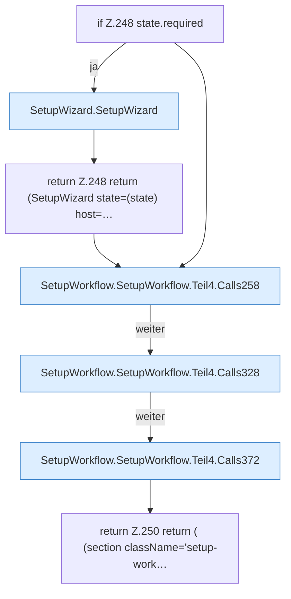

[[00 Start]] › [[Dashboard-UI]] › [[UI-Workflows]] › [[SetupWorkflow]] › [[SetupWorkflow.SetupWorkflow]] › [[SetupWorkflow.SetupWorkflow.Teil4]]

# SetupWorkflow.SetupWorkflow.Teil4

- Fortsetzung von `SetupWorkflow.SetupWorkflow`, Quellreihenfolge.
