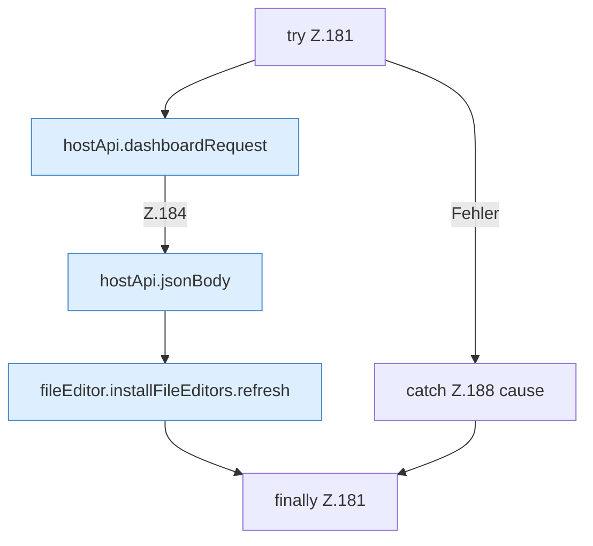

[[00 Start]] › [[Dashboard-UI]] › [[UI-Workflows]] › [[SetupWorkflow]] › [[SetupWorkflow.SetupWorkflow]] › [[SetupWorkflow.SetupWorkflow.cleanupLegacy]] › [[SetupWorkflow.SetupWorkflow.cleanupLegacy.Z181]]

# SetupWorkflow.SetupWorkflow.cleanupLegacy.Z181



```knoten
try Z.181
  Zeile 181: Versuch. Der Fehlerpfad geht in catch.
hostApi.dashboardRequest
  `dashboardRequest` in `hostApi.ts`.
hostApi.jsonBody
  Antwortet mit JSON `jsonBody`.
fileEditor.installFileEditors.refresh
  Lädt neu `refresh`. Ruft `editorFor`.
catch Z.188 cause
  Zeile 188: fängt cause.
finally Z.181
  Läuft danach immer, auch nach einem Fehler.
```

- Fortsetzung von `SetupWorkflow.SetupWorkflow.cleanupLegacy`, Quellreihenfolge.
