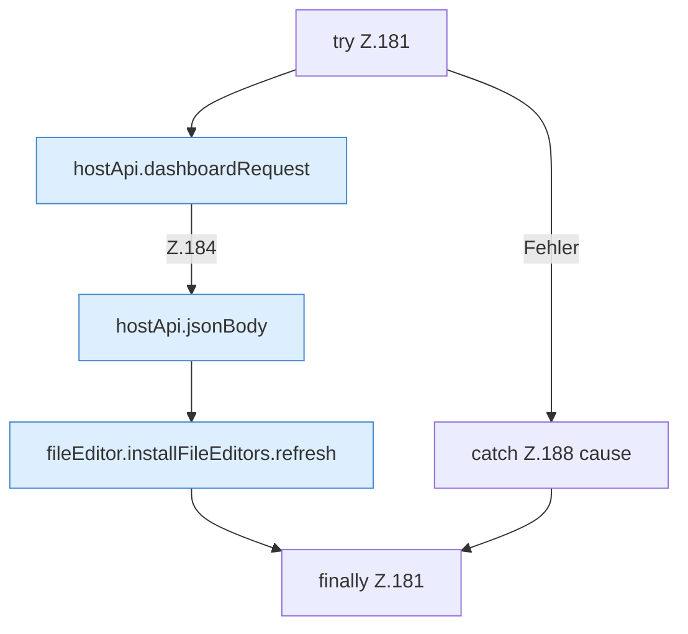

[[00 Start]] › [[Dashboard-UI]] › [[UI-Workflows]] › [[SetupWorkflow]] › [[SetupWorkflow.SetupWorkflow]] › [[SetupWorkflow.SetupWorkflow.cleanupLegacy]] › [[SetupWorkflow.SetupWorkflow.cleanupLegacy.Z181]]

# SetupWorkflow.SetupWorkflow.cleanupLegacy.Z181

- Fortsetzung von `SetupWorkflow.SetupWorkflow.cleanupLegacy`, Quellreihenfolge.
