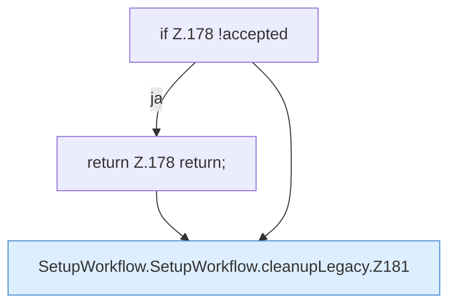

[[00 Start]] › [[Dashboard-UI]] › [[UI-Workflows]] › [[SetupWorkflow]] › [[SetupWorkflow.SetupWorkflow]] › [[SetupWorkflow.SetupWorkflow.cleanupLegacy]]

# SetupWorkflow.SetupWorkflow.cleanupLegacy

`SetupWorkflow.cleanupLegacy()` [ui/src/components/SetupWorkflow.tsx:171–193](https://github.com/Sciddie/minecraft-serverhoster-plugin/blob/95b02b953b0b4c23673e900e021a7c3c844aa37d/ui/src/components/SetupWorkflow.tsx#L171-L193)



```knoten
if Z.178 !accepted
  Zeile 178: prüft `!accepted`.
return Z.178 return;
  Zeile 178: Rückgabe `return;`.
SetupWorkflow.SetupWorkflow.cleanupLegacy.Z181
  Fortsetzung des Ablaufs ab Zeile 181.
```

- `cleanupLegacy` in `ui/src/components/SetupWorkflow.tsx`
