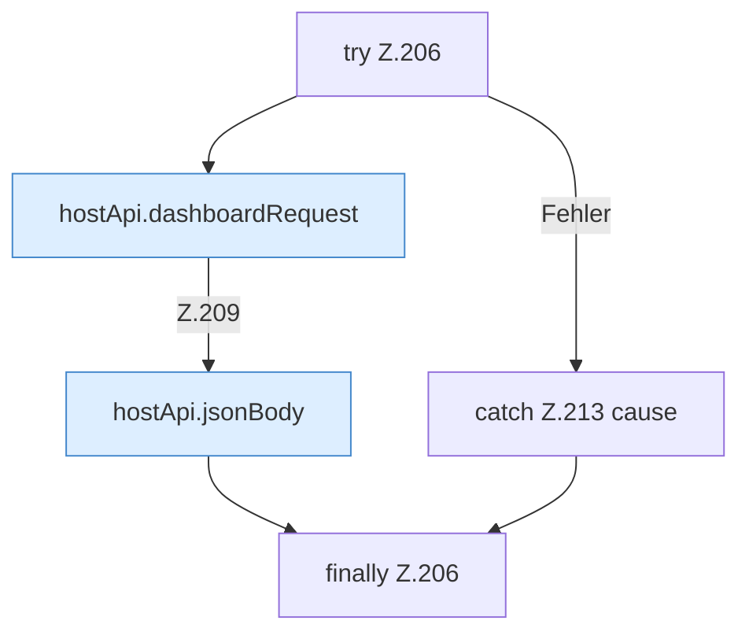

[[00 Start]] › [[Dashboard-UI]] › [[UI-Workflows]] › [[SetupWorkflow]] › [[SetupWorkflow.SetupWorkflow]] › [[SetupWorkflow.SetupWorkflow.hostAction]] › [[SetupWorkflow.SetupWorkflow.hostAction.Z206]]

# SetupWorkflow.SetupWorkflow.hostAction.Z206



```knoten
try Z.206
  Zeile 206: Versuch. Der Fehlerpfad geht in catch.
hostApi.dashboardRequest
  Schickt von der [[Glossar#Bedienseite|Bedienseite]] eine Anfrage an das [[Glossar#Plugin|Plugin]]. `dashboardRequest` in `hostApi.ts`.
hostApi.jsonBody
  Baut den Text, den die [[Glossar#Bedienseite|Bedienseite]] als Auftrag mitschickt. Antwortet mit JSON `jsonBody`.
catch Z.213 cause
  Zeile 213: fängt cause.
finally Z.206
  Läuft danach immer, auch nach einem Fehler.
```

> [!knoten]- Was die Blöcke tun
> - **try Z.206**: Zeile 206: Versuch. Der Fehlerpfad geht in catch.
> - **hostApi.dashboardRequest**: Schickt von der [[Glossar#Bedienseite|Bedienseite]] eine Anfrage an das [[Glossar#Plugin|Plugin]]. `dashboardRequest` in `hostApi.ts`.
> - **hostApi.jsonBody**: Baut den Text, den die [[Glossar#Bedienseite|Bedienseite]] als Auftrag mitschickt. Antwortet mit JSON `jsonBody`.
> - **catch Z.213 cause**: Zeile 213: fängt cause.
> - **finally Z.206**: Läuft danach immer, auch nach einem Fehler.

- Der Ablauf geht in [[Glossar#Zeile|Zeile]] 206 weiter. Eine Ebene tiefer steht er genauer.
- Fortsetzung von `SetupWorkflow.SetupWorkflow.hostAction`.
