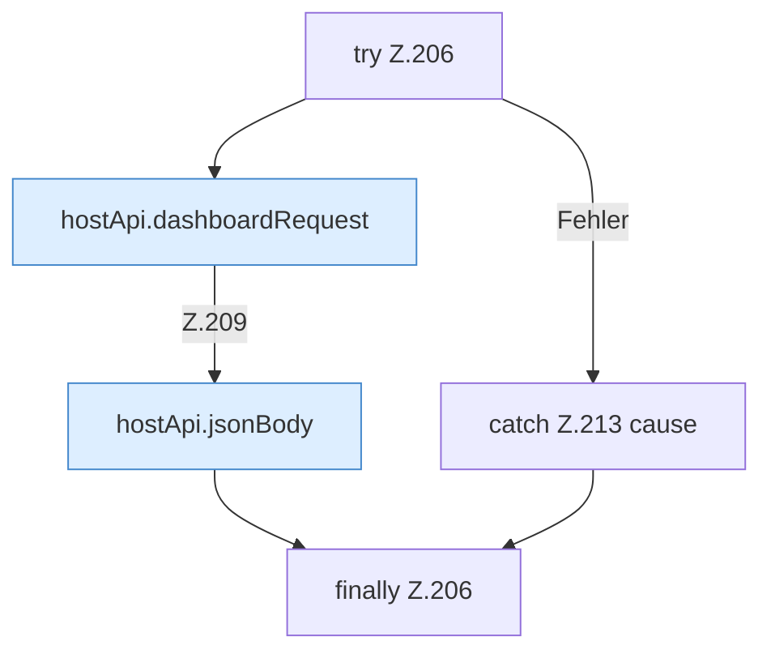

[[00 Start]] › [[Dashboard-UI]] › [[UI-Workflows]] › [[SetupWorkflow]] › [[SetupWorkflow.SetupWorkflow]] › [[SetupWorkflow.SetupWorkflow.hostAction]] › [[SetupWorkflow.SetupWorkflow.hostAction.Z206]]

# SetupWorkflow.SetupWorkflow.hostAction.Z206

- Fortsetzung von `SetupWorkflow.SetupWorkflow.hostAction`, Quellreihenfolge.
