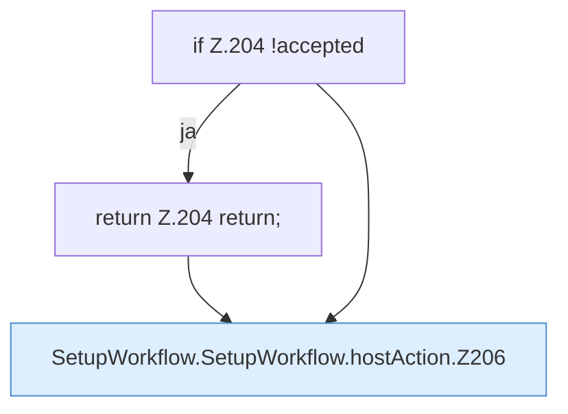

[[00 Start]] › [[Dashboard-UI]] › [[UI-Workflows]] › [[SetupWorkflow]] › [[SetupWorkflow.SetupWorkflow]] › [[SetupWorkflow.SetupWorkflow.hostAction]]

# SetupWorkflow.SetupWorkflow.hostAction

`SetupWorkflow.hostAction(action: "apply" | "rollback", required: string)` [ui/src/components/SetupWorkflow.tsx:195–218](https://github.com/Sciddie/minecraft-serverhoster-plugin/blob/95b02b953b0b4c23673e900e021a7c3c844aa37d/ui/src/components/SetupWorkflow.tsx#L195-L218)

- `hostAction` in `ui/src/components/SetupWorkflow.tsx`
