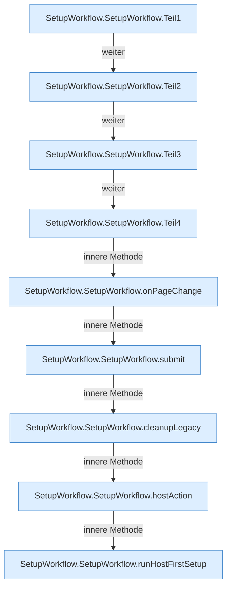

[[00 Start]] › [[Dashboard-UI]] › [[UI-Workflows]] › [[SetupWorkflow]] › [[SetupWorkflow.SetupWorkflow]]

# SetupWorkflow.SetupWorkflow

`SetupWorkflow.SetupWorkflow()` [ui/src/components/SetupWorkflow.tsx:44–392](https://github.com/Sciddie/minecraft-serverhoster-plugin/blob/95b02b953b0b4c23673e900e021a7c3c844aa37d/ui/src/components/SetupWorkflow.tsx#L44-L392)



```knoten
SetupWorkflow.SetupWorkflow.Teil1
  Ein weiterer Abschnitt derselben Übersicht. Abschnitt 1 dieses Ablaufs, in Quellreihenfolge.
SetupWorkflow.SetupWorkflow.Teil2
  Ein weiterer Abschnitt derselben Übersicht. Abschnitt 2 dieses Ablaufs, in Quellreihenfolge.
SetupWorkflow.SetupWorkflow.Teil3
  Ein weiterer Abschnitt derselben Übersicht. Abschnitt 3 dieses Ablaufs, in Quellreihenfolge.
SetupWorkflow.SetupWorkflow.Teil4
  Ein weiterer Abschnitt derselben Übersicht. Abschnitt 4 dieses Ablaufs, in Quellreihenfolge.
SetupWorkflow.SetupWorkflow.onPageChange
  Die [[Glossar#Bedienseite|Bedienseite]] macht hier einen einzelnen Schritt. Eine Ebene tiefer steht er genauer. Reagiert `onPageChange`. Ruft `refresh`.
SetupWorkflow.SetupWorkflow.submit
  Die [[Glossar#Bedienseite|Bedienseite]] macht hier einen einzelnen Schritt. Eine Ebene tiefer steht er genauer. Gibt ab `submit`. Ruft `versionIsValid`, `dashboardRequest`, `jsonBody`.
SetupWorkflow.SetupWorkflow.cleanupLegacy
  Die [[Glossar#Bedienseite|Bedienseite]] räumt auf den alten Weg. Räumt auf `cleanupLegacy`. Ruft `dashboardRequest`, `jsonBody`, `refresh`.
SetupWorkflow.SetupWorkflow.hostAction
  Die [[Glossar#Bedienseite|Bedienseite]] kümmert sich um die Tätigkeit. Betrifft den [[Glossar#Host|Host]] `hostAction`. Ruft `dashboardRequest`, `jsonBody`.
SetupWorkflow.SetupWorkflow.runHostFirstSetup
  Die [[Glossar#Bedienseite|Bedienseite]] führt aus den [[Glossar#Host|Host]] die erste die [[Glossar#Einrichtung|Einrichtung]]. Führt aus `runHostFirstSetup`. Ruft `dashboardRequest`, `jsonBody`.
```

> [!knoten]- Was die Blöcke tun
> - **SetupWorkflow.SetupWorkflow.Teil1**: Ein weiterer Abschnitt derselben Übersicht. Abschnitt 1 dieses Ablaufs, in Quellreihenfolge.
> - **SetupWorkflow.SetupWorkflow.Teil2**: Ein weiterer Abschnitt derselben Übersicht. Abschnitt 2 dieses Ablaufs, in Quellreihenfolge.
> - **SetupWorkflow.SetupWorkflow.Teil3**: Ein weiterer Abschnitt derselben Übersicht. Abschnitt 3 dieses Ablaufs, in Quellreihenfolge.
> - **SetupWorkflow.SetupWorkflow.Teil4**: Ein weiterer Abschnitt derselben Übersicht. Abschnitt 4 dieses Ablaufs, in Quellreihenfolge.
> - **SetupWorkflow.SetupWorkflow.onPageChange**: Die [[Glossar#Bedienseite|Bedienseite]] macht hier einen einzelnen Schritt. Eine Ebene tiefer steht er genauer. Reagiert `onPageChange`. Ruft `refresh`.
> - **SetupWorkflow.SetupWorkflow.submit**: Die [[Glossar#Bedienseite|Bedienseite]] macht hier einen einzelnen Schritt. Eine Ebene tiefer steht er genauer. Gibt ab `submit`. Ruft `versionIsValid`, `dashboardRequest`, `jsonBody`.
> - **SetupWorkflow.SetupWorkflow.cleanupLegacy**: Die [[Glossar#Bedienseite|Bedienseite]] räumt auf den alten Weg. Räumt auf `cleanupLegacy`. Ruft `dashboardRequest`, `jsonBody`, `refresh`.
> - **SetupWorkflow.SetupWorkflow.hostAction**: Die [[Glossar#Bedienseite|Bedienseite]] kümmert sich um die Tätigkeit. Betrifft den [[Glossar#Host|Host]] `hostAction`. Ruft `dashboardRequest`, `jsonBody`.
> - **SetupWorkflow.SetupWorkflow.runHostFirstSetup**: Die [[Glossar#Bedienseite|Bedienseite]] führt aus den [[Glossar#Host|Host]] die erste die [[Glossar#Einrichtung|Einrichtung]]. Führt aus `runHostFirstSetup`. Ruft `dashboardRequest`, `jsonBody`.

- Die [[Glossar#Bedienseite|Bedienseite]] kümmert sich um den Ablauf.
- `SetupWorkflow` in `ui/src/components/SetupWorkflow.tsx`
