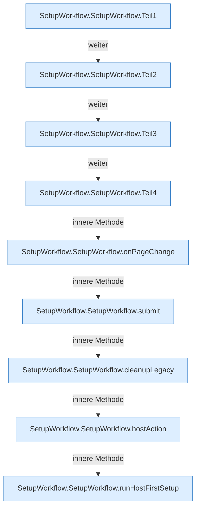

[[00 Start]] › [[Dashboard-UI]] › [[UI-Workflows]] › [[SetupWorkflow]] › [[SetupWorkflow.SetupWorkflow]]

# SetupWorkflow.SetupWorkflow

`SetupWorkflow.SetupWorkflow()` [ui/src/components/SetupWorkflow.tsx:44–392](https://github.com/Sciddie/minecraft-serverhoster-plugin/blob/95b02b953b0b4c23673e900e021a7c3c844aa37d/ui/src/components/SetupWorkflow.tsx#L44-L392)

- `SetupWorkflow` in `ui/src/components/SetupWorkflow.tsx`
