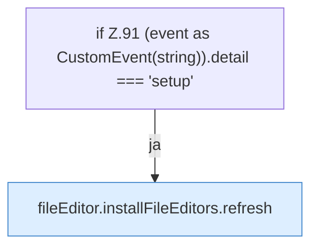

[[00 Start]] › [[Dashboard-UI]] › [[UI-Workflows]] › [[SetupWorkflow]] › [[SetupWorkflow.SetupWorkflow]] › [[SetupWorkflow.SetupWorkflow.onPageChange]]

# SetupWorkflow.SetupWorkflow.onPageChange

`SetupWorkflow.onPageChange(event: Event)` [ui/src/components/SetupWorkflow.tsx:90–92](https://github.com/Sciddie/minecraft-serverhoster-plugin/blob/95b02b953b0b4c23673e900e021a7c3c844aa37d/ui/src/components/SetupWorkflow.tsx#L90-L92)



```knoten
if Z.91 (event as CustomEvent(string)).detail === 'setup'
  Zeile 91: prüft `(event as CustomEvent(string)).detail === 'setup'`.
fileEditor.installFileEditors.refresh
  Lädt neu `refresh`. Ruft `editorFor`.
```

- `onPageChange` in `ui/src/components/SetupWorkflow.tsx`
