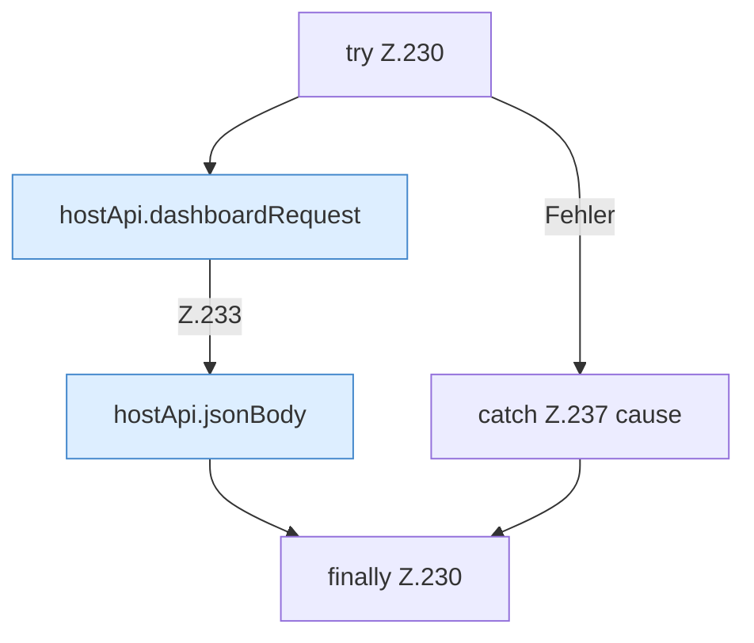

[[00 Start]] › [[Dashboard-UI]] › [[UI-Workflows]] › [[SetupWorkflow]] › [[SetupWorkflow.SetupWorkflow]] › [[SetupWorkflow.SetupWorkflow.runHostFirstSetup]] › [[SetupWorkflow.SetupWorkflow.runHostFirstSetup.Z230]]

# SetupWorkflow.SetupWorkflow.runHostFirstSetup.Z230

- Fortsetzung von `SetupWorkflow.SetupWorkflow.runHostFirstSetup`, Quellreihenfolge.
