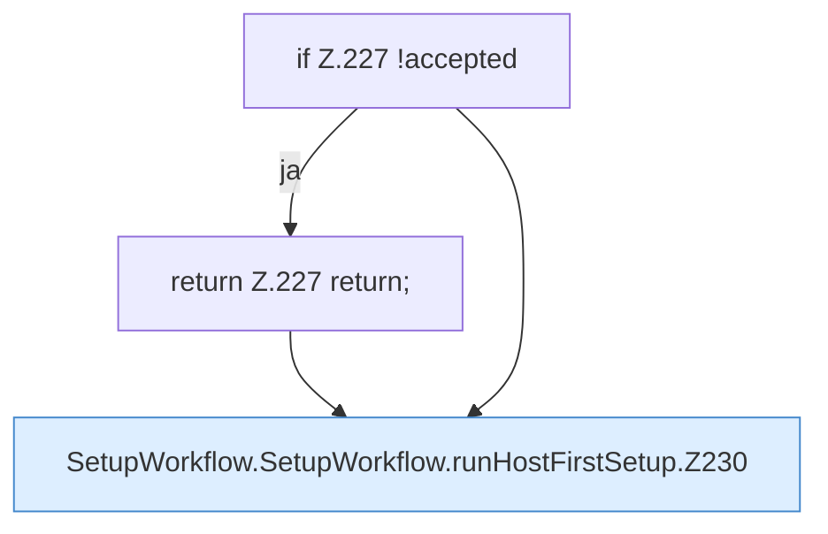

[[00 Start]] › [[Dashboard-UI]] › [[UI-Workflows]] › [[SetupWorkflow]] › [[SetupWorkflow.SetupWorkflow]] › [[SetupWorkflow.SetupWorkflow.runHostFirstSetup]]

# SetupWorkflow.SetupWorkflow.runHostFirstSetup

`SetupWorkflow.runHostFirstSetup(required: string)` [ui/src/components/SetupWorkflow.tsx:220–242](https://github.com/Sciddie/minecraft-serverhoster-plugin/blob/95b02b953b0b4c23673e900e021a7c3c844aa37d/ui/src/components/SetupWorkflow.tsx#L220-L242)



```knoten
if Z.227 !accepted
  Zeile 227: prüft `!accepted`.
return Z.227 return;
  Zeile 227: Rückgabe `return;`.
SetupWorkflow.SetupWorkflow.runHostFirstSetup.Z230
  Der Ablauf geht in [[Glossar#Zeile|Zeile]] 230 weiter. Eine Ebene tiefer steht er genauer. Fortsetzung des Ablaufs ab Zeile 230.
```

> [!knoten]- Was die Blöcke tun
> - **if Z.227 !accepted**: Zeile 227: prüft `!accepted`.
> - **return Z.227 return;**: Zeile 227: Rückgabe `return;`.
> - **SetupWorkflow.SetupWorkflow.runHostFirstSetup.Z230**: Der Ablauf geht in [[Glossar#Zeile|Zeile]] 230 weiter. Eine Ebene tiefer steht er genauer. Fortsetzung des Ablaufs ab Zeile 230.

- Die [[Glossar#Bedienseite|Bedienseite]] führt aus den [[Glossar#Host|Host]] die erste die [[Glossar#Einrichtung|Einrichtung]].
- `runHostFirstSetup` in `ui/src/components/SetupWorkflow.tsx`
