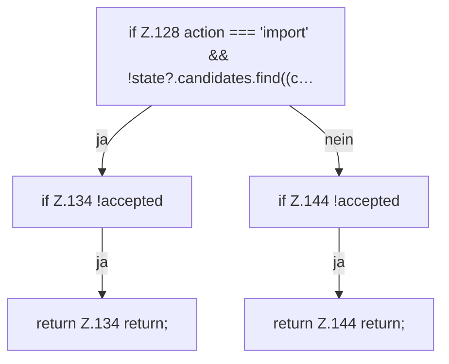

[[00 Start]] › [[Dashboard-UI]] › [[UI-Workflows]] › [[SetupWorkflow]] › [[SetupWorkflow.SetupWorkflow]] › [[SetupWorkflow.SetupWorkflow.submit]] › [[SetupWorkflow.SetupWorkflow.submit.Z100.Teil1.Z106.Z117.Z128]]

# SetupWorkflow.SetupWorkflow.submit.Z100.Teil1.Z106.Z117.Z128



```knoten
if Z.128 action === 'import' && !state?.candidates.find((c…
  Zeile 128: prüft `action === 'import' && !state?.candidates.find((c…`.
if Z.134 !accepted
  Zeile 134: prüft `!accepted`.
return Z.134 return;
  Zeile 134: Rückgabe `return;`.
if Z.144 !accepted
  Zeile 144: prüft `!accepted`.
return Z.144 return;
  Zeile 144: Rückgabe `return;`.
```

> [!knoten]- Was die Blöcke tun
> - **if Z.128 action === 'import' && !state?.candidates.find((c…**: Zeile 128: prüft `action === 'import' && !state?.candidates.find((c…`.
> - **if Z.134 !accepted**: Zeile 134: prüft `!accepted`.
> - **return Z.134 return;**: Zeile 134: Rückgabe `return;`.
> - **if Z.144 !accepted**: Zeile 144: prüft `!accepted`.
> - **return Z.144 return;**: Zeile 144: Rückgabe `return;`.

- Der Ablauf geht in [[Glossar#Zeile|Zeile]] 128 weiter. Eine Ebene tiefer steht er genauer.
- Fortsetzung von `SetupWorkflow.SetupWorkflow.submit.Z100.Teil1.Z106.Z117`.
