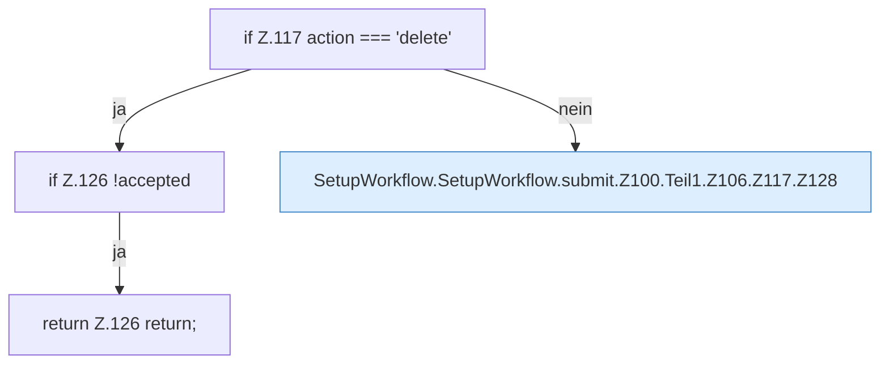

[[00 Start]] › [[Dashboard-UI]] › [[UI-Workflows]] › [[SetupWorkflow]] › [[SetupWorkflow.SetupWorkflow]] › [[SetupWorkflow.SetupWorkflow.submit]] › [[SetupWorkflow.SetupWorkflow.submit.Z100.Teil1.Z106.Z117]]

# SetupWorkflow.SetupWorkflow.submit.Z100.Teil1.Z106.Z117



```knoten
if Z.117 action === 'delete'
  Zeile 117: prüft `action === 'delete'`.
if Z.126 !accepted
  Zeile 126: prüft `!accepted`.
return Z.126 return;
  Zeile 126: Rückgabe `return;`.
SetupWorkflow.SetupWorkflow.submit.Z100.Teil1.Z106.Z117.Z128
  Der Ablauf geht in [[Glossar#Zeile|Zeile]] 128 weiter. Eine Ebene tiefer steht er genauer. Fortsetzung des Ablaufs ab Zeile 128.
```

> [!knoten]- Was die Blöcke tun
> - **if Z.117 action === 'delete'**: Zeile 117: prüft `action === 'delete'`.
> - **if Z.126 !accepted**: Zeile 126: prüft `!accepted`.
> - **return Z.126 return;**: Zeile 126: Rückgabe `return;`.
> - **SetupWorkflow.SetupWorkflow.submit.Z100.Teil1.Z106.Z117.Z128**: Der Ablauf geht in [[Glossar#Zeile|Zeile]] 128 weiter. Eine Ebene tiefer steht er genauer. Fortsetzung des Ablaufs ab Zeile 128.

- Der Ablauf geht in [[Glossar#Zeile|Zeile]] 117 weiter. Eine Ebene tiefer steht er genauer.
- Fortsetzung von `SetupWorkflow.SetupWorkflow.submit.Z100.Teil1.Z106`.
