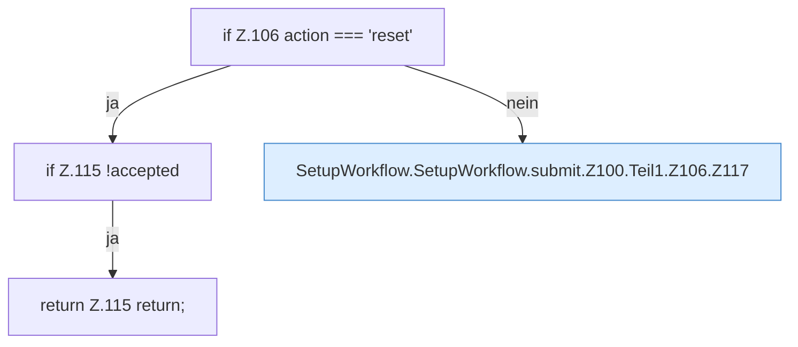

[[00 Start]] › [[Dashboard-UI]] › [[UI-Workflows]] › [[SetupWorkflow]] › [[SetupWorkflow.SetupWorkflow]] › [[SetupWorkflow.SetupWorkflow.submit]] › [[SetupWorkflow.SetupWorkflow.submit.Z100.Teil1.Z106]]

# SetupWorkflow.SetupWorkflow.submit.Z100.Teil1.Z106

- Fortsetzung von `SetupWorkflow.SetupWorkflow.submit.Z100.Teil1`, Quellreihenfolge.
