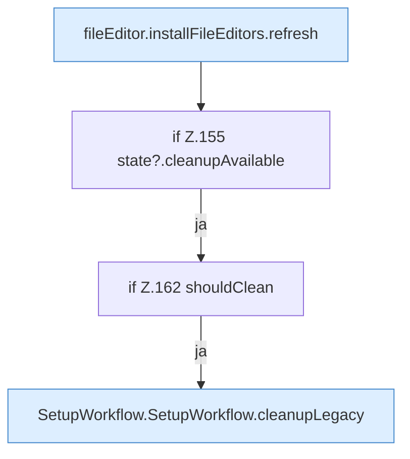

[[00 Start]] › [[Dashboard-UI]] › [[UI-Workflows]] › [[SetupWorkflow]] › [[SetupWorkflow.SetupWorkflow]] › [[SetupWorkflow.SetupWorkflow.submit]] › [[SetupWorkflow.SetupWorkflow.submit.Z100.Teil2]]

# SetupWorkflow.SetupWorkflow.submit.Z100.Teil2



```knoten
fileEditor.installFileEditors.refresh
  Lädt neu `refresh`. Ruft `editorFor`.
if Z.155 state?.cleanupAvailable
  Zeile 155: prüft `state?.cleanupAvailable`.
if Z.162 shouldClean
  Zeile 162: prüft `shouldClean`.
SetupWorkflow.SetupWorkflow.cleanupLegacy
  Räumt auf `cleanupLegacy`. Ruft `dashboardRequest`, `jsonBody`, `refresh`.
```

- Fortsetzung von `SetupWorkflow.SetupWorkflow.submit.Z100`, Quellreihenfolge.
