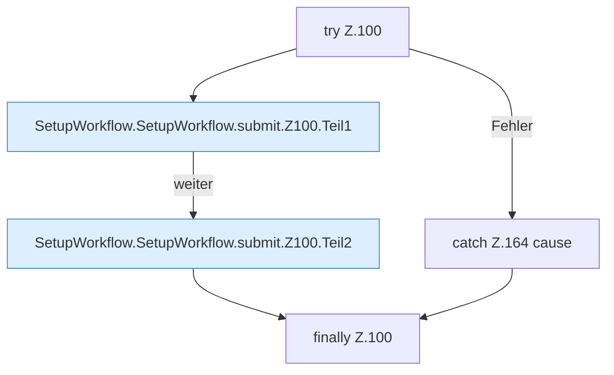

[[00 Start]] › [[Dashboard-UI]] › [[UI-Workflows]] › [[SetupWorkflow]] › [[SetupWorkflow.SetupWorkflow]] › [[SetupWorkflow.SetupWorkflow.submit]] › [[SetupWorkflow.SetupWorkflow.submit.Z100]]

# SetupWorkflow.SetupWorkflow.submit.Z100



```knoten
try Z.100
  Zeile 100: Versuch. Der Fehlerpfad geht in catch.
SetupWorkflow.SetupWorkflow.submit.Z100.Teil1
  Abschnitt 1 dieses Ablaufs, in Quellreihenfolge.
SetupWorkflow.SetupWorkflow.submit.Z100.Teil2
  Abschnitt 2 dieses Ablaufs, in Quellreihenfolge.
catch Z.164 cause
  Zeile 164: fängt cause.
finally Z.100
  Läuft danach immer, auch nach einem Fehler.
```

- Fortsetzung von `SetupWorkflow.SetupWorkflow.submit`, Quellreihenfolge.
