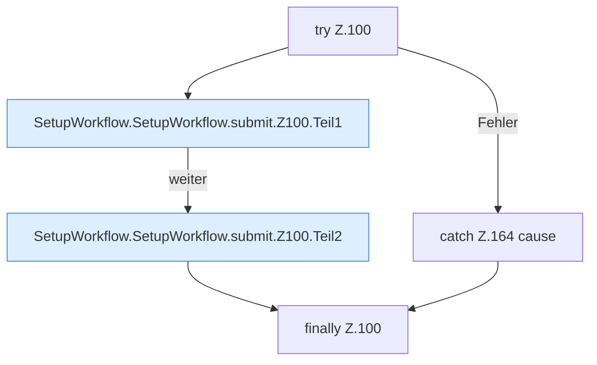

[[00 Start]] › [[Dashboard-UI]] › [[UI-Workflows]] › [[SetupWorkflow]] › [[SetupWorkflow.SetupWorkflow]] › [[SetupWorkflow.SetupWorkflow.submit]] › [[SetupWorkflow.SetupWorkflow.submit.Z100]]

# SetupWorkflow.SetupWorkflow.submit.Z100

- Fortsetzung von `SetupWorkflow.SetupWorkflow.submit`, Quellreihenfolge.
