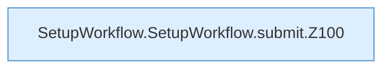

[[00 Start]] › [[Dashboard-UI]] › [[UI-Workflows]] › [[SetupWorkflow]] › [[SetupWorkflow.SetupWorkflow]] › [[SetupWorkflow.SetupWorkflow.submit]]

# SetupWorkflow.SetupWorkflow.submit

`SetupWorkflow.submit(action: "attach" | "delete" | "import" | "new" | "reset")` [ui/src/components/SetupWorkflow.tsx:97–169](https://github.com/Sciddie/minecraft-serverhoster-plugin/blob/95b02b953b0b4c23673e900e021a7c3c844aa37d/ui/src/components/SetupWorkflow.tsx#L97-L169)



```knoten
SetupWorkflow.SetupWorkflow.submit.Z100
  Der Ablauf geht in [[Glossar#Zeile|Zeile]] 100 weiter. Eine Ebene tiefer steht er genauer. Fortsetzung des Ablaufs ab Zeile 100.
```

> [!knoten]- Was die Blöcke tun
> - **SetupWorkflow.SetupWorkflow.submit.Z100**: Der Ablauf geht in [[Glossar#Zeile|Zeile]] 100 weiter. Eine Ebene tiefer steht er genauer. Fortsetzung des Ablaufs ab Zeile 100.

- Die [[Glossar#Bedienseite|Bedienseite]] macht hier einen einzelnen Schritt. Eine Ebene tiefer steht er genauer.
- `submit` in `ui/src/components/SetupWorkflow.tsx`
