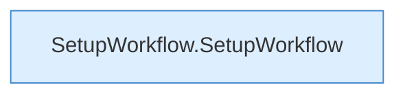

[[00 Start]] › [[Dashboard-UI]] › [[UI-Workflows]] › [[SetupWorkflow]]

# SetupWorkflow



```knoten
SetupWorkflow.SetupWorkflow
  Die [[Glossar#Bedienseite|Bedienseite]] kümmert sich um den Ablauf. Im [[Glossar#Quelltext|Quelltext]] heißt das `SetupWorkflow`.
```

> [!knoten]- Was die Blöcke tun
> - **SetupWorkflow.SetupWorkflow**: Die [[Glossar#Bedienseite|Bedienseite]] kümmert sich um den Ablauf. Im [[Glossar#Quelltext|Quelltext]] heißt das `SetupWorkflow`.

- Die Einrichtungsseite in der [[Glossar#Bedienseite|Bedienseite]].
