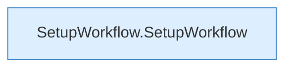

[[00 Start]] › [[Dashboard-UI]] › [[UI-Workflows]] › [[SetupWorkflow]]

# SetupWorkflow



```knoten
SetupWorkflow.SetupWorkflow
  `SetupWorkflow` in `SetupWorkflow.tsx`. Ruft `dashboardRequest`, `refresh`, `SetupWizard`.
```


