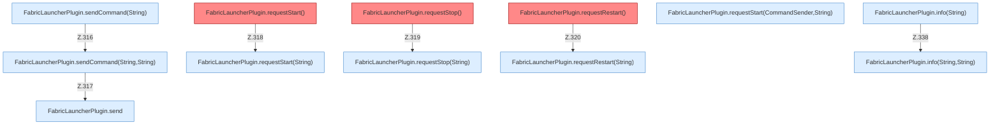

[[00 Start]] › [[Plugin-Kern]] › [[Slot-Aktionen]]

# Slot-Aktionen



```knoten
FabricLauncherPlugin.sendCommand(String)
  Sendet `sendCommand`. Ruft `sendCommand`.
FabricLauncherPlugin.sendCommand(String,String)
  Sendet `sendCommand`. Ruft `send`, `slot`.
FabricLauncherPlugin.requestStart()
  Fordert an `requestStart`. Ruft `requestStart`. Befund: toter Code (sicher).
FabricLauncherPlugin.requestStop()
  Fordert an `requestStop`. Ruft `requestStop`. Befund: toter Code (sicher).
FabricLauncherPlugin.requestRestart()
  Fordert an `requestRestart`. Ruft `requestRestart`. Befund: toter Code (sicher).
FabricLauncherPlugin.requestStart(String)
  Fordert an `requestStart`. Ruft `startAsync`.
FabricLauncherPlugin.requestStart(CommandSender,String)
  Fordert an `requestStart`. Ruft `startAsync`.
FabricLauncherPlugin.requestStop(String)
  Fordert an `requestStop`. Ruft `slot`, `stopBlocking`.
FabricLauncherPlugin.requestRestart(String)
  Fordert an `requestRestart`. Ruft `slot`, `stopBlocking`, `reloadProfiles`.
FabricLauncherPlugin.info(String)
  Schreibt eine Infozeile `info`. Ruft `info`.
FabricLauncherPlugin.info(String,String)
  Schreibt eine Infozeile `info`. Ruft `slot`.
FabricLauncherPlugin.send
  Sendet `send`. Ruft `running`.
```


