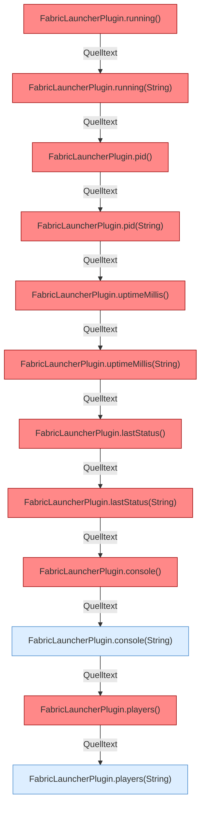

[[00 Start]] › [[Plugin-Kern]] › [[Slot-Status]]

# Slot-Status



```knoten
FabricLauncherPlugin.running()
  Sagt, ob der Prozess läuft `running`. Ruft `focusSlot`, `running`. Befund: toter Code (prüfen).
FabricLauncherPlugin.running(String)
  Sagt, ob der Prozess läuft `running`. Ruft `slot`, `running`. Befund: toter Code (prüfen).
FabricLauncherPlugin.pid()
  Liefert die Prozessnummer `pid`. Ruft `focusSlot`, `pid`. Befund: toter Code (prüfen).
FabricLauncherPlugin.pid(String)
  Liefert die Prozessnummer `pid`. Ruft `slot`, `pid`. Befund: toter Code (prüfen).
FabricLauncherPlugin.uptimeMillis()
  Liefert die Laufzeit `uptimeMillis`. Ruft `focusSlot`, `uptimeMillis`. Befund: toter Code (sicher).
FabricLauncherPlugin.uptimeMillis(String)
  Liefert die Laufzeit `uptimeMillis`. Ruft `slot`, `uptimeMillis`. Befund: toter Code (sicher).
FabricLauncherPlugin.lastStatus()
  `lastStatus` in `FabricLauncherPlugin.java`. Ruft `focusSlot`. Befund: toter Code (sicher).
FabricLauncherPlugin.lastStatus(String)
  `lastStatus` in `FabricLauncherPlugin.java`. Ruft `slot`. Befund: toter Code (sicher).
FabricLauncherPlugin.console()
  Liefert die Konsole `console`. Ruft `focusSlot`. Befund: toter Code (prüfen).
FabricLauncherPlugin.console(String)
  Liefert die Konsole `console`. Ruft `slot`.
FabricLauncherPlugin.players()
  Liefert die Spieler `players`. Ruft `focusSlot`. Befund: toter Code (prüfen).
FabricLauncherPlugin.players(String)
  Liefert die Spieler `players`. Ruft `slot`.
```


