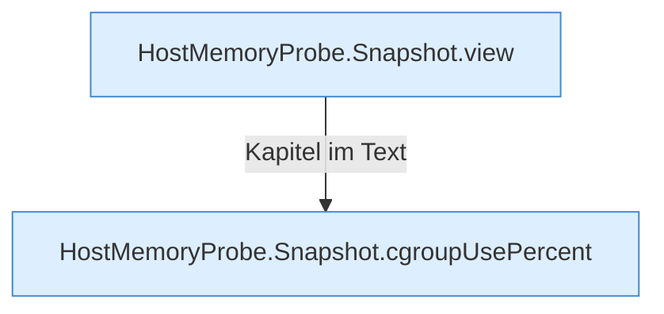

[[00 Start]] › [[Host-Betrieb]] › [[Speicher-Messung]] › [[HostMemoryProbe]] › [[Snapshot]]

# Snapshot



```knoten
HostMemoryProbe.Snapshot.view
  Die Messung macht hier einen einzelnen Schritt. Eine Ebene tiefer steht er genauer. Liefert die Sicht `view`.
HostMemoryProbe.Snapshot.cgroupUsePercent
  Die Messung macht hier einen einzelnen Schritt. Eine Ebene tiefer steht er genauer. `cgroupUsePercent` in `HostMemoryProbe.java`.
```

> [!knoten]- Was die Blöcke tun
> - **HostMemoryProbe.Snapshot.view**: Die Messung macht hier einen einzelnen Schritt. Eine Ebene tiefer steht er genauer. Liefert die Sicht `view`.
> - **HostMemoryProbe.Snapshot.cgroupUsePercent**: Die Messung macht hier einen einzelnen Schritt. Eine Ebene tiefer steht er genauer. `cgroupUsePercent` in `HostMemoryProbe.java`.

- Eine einzelne Messung: freier Speicher und Wechselbereich in diesem Moment.
