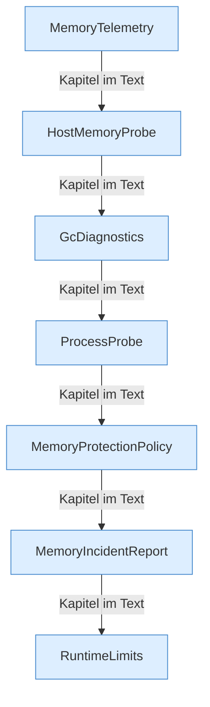

[[00 Start]] › [[Host-Betrieb]] › [[Speicher-Messung]]

# Speicher-Messung



```knoten
MemoryTelemetry
  Rechnet die Speicherzahlen in eine gut lesbare Einheit um.
HostMemoryProbe
  Liest, wie viel [[Glossar#Arbeitsspeicher|Arbeitsspeicher]] auf dem [[Glossar#Host|Host]] noch frei ist, inklusive des Wechselbereichs.
GcDiagnostics
  Sammelt Angaben zur automatischen Speicherbereinigung für den Text eines [[Glossar#Vorfall|Vorfalls]].
ProcessProbe
  Fragt das laufende Programm über ein Hilfswerkzeug des Java nach seinem Zustand. Die Frage wartet höchstens zwanzig Sekunden.
MemoryProtectionPolicy
  Die Entscheidung bei Speichermangel: nichts tun, den [[Glossar#Spielserver|Spielserver]] stoppen, oder eine zuvor vergebene Reserve wieder freigeben.
MemoryIncidentReport
  Schreibt den Text auf, wenn der [[Glossar#Arbeitsspeicher|Arbeitsspeicher]] knapp wurde.
RuntimeLimits
  Hält Zahlen in einem erlaubten Bereich, damit eine Einstellung nicht unsinnig groß oder klein wird. Die Frist beim Ausschalten des [[Glossar#Host|Host]] ist so begrenzt, Ersatzwert 25 Sekunden.
```

> [!knoten] Was die Blöcke tun
> - **MemoryTelemetry**: Rechnet die Speicherzahlen in eine gut lesbare Einheit um.
> - **HostMemoryProbe**: Liest, wie viel [[Glossar#Arbeitsspeicher|Arbeitsspeicher]] auf dem [[Glossar#Host|Host]] noch frei ist, inklusive des Wechselbereichs.
> - **GcDiagnostics**: Sammelt Angaben zur automatischen Speicherbereinigung für den Text eines [[Glossar#Vorfall|Vorfalls]].
> - **ProcessProbe**: Fragt das laufende Programm über ein Hilfswerkzeug des Java nach seinem Zustand. Die Frage wartet höchstens zwanzig Sekunden.
> - **MemoryProtectionPolicy**: Die Entscheidung bei Speichermangel: nichts tun, den [[Glossar#Spielserver|Spielserver]] stoppen, oder eine zuvor vergebene Reserve wieder freigeben.
> - **MemoryIncidentReport**: Schreibt den Text auf, wenn der [[Glossar#Arbeitsspeicher|Arbeitsspeicher]] knapp wurde.
> - **RuntimeLimits**: Hält Zahlen in einem erlaubten Bereich, damit eine Einstellung nicht unsinnig groß oder klein wird. Die Frist beim Ausschalten des [[Glossar#Host|Host]] ist so begrenzt, Ersatzwert 25 Sekunden.

- Die Teile, die den [[Glossar#Arbeitsspeicher|Arbeitsspeicher]] messen, bewerten und bei einem [[Glossar#Vorfall|Vorfall]] einen Text schreiben.
