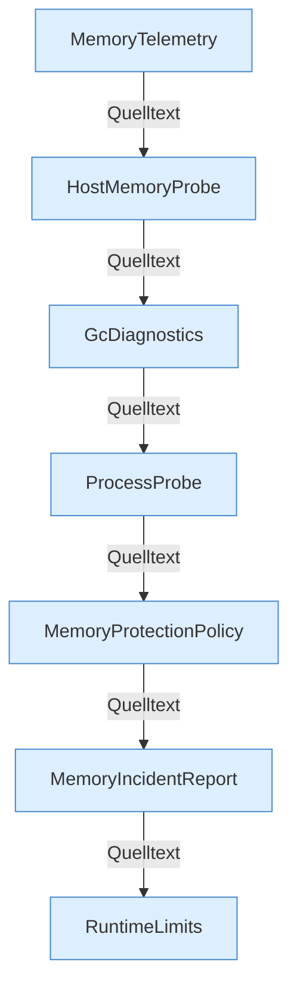

[[00 Start]] › [[Host-Betrieb]] › [[Speicher-Messung]]

# Speicher-Messung



```knoten
MemoryTelemetry
  Heap- und Host-Zahlen, umgerechnet in MiB.
HostMemoryProbe
  Liest freien Speicher, Swap und die cgroup.
GcDiagnostics
  Sammelt GC-Daten für den Vorfallbericht.
ProcessProbe
  jcmd, Timeout 20 s, Thread FabricLauncher-jcmd.
MemoryProtectionPolicy
  Entscheidung NONE, STOP_CHILD, RELEASE_AFTER_STABLE_MEMORY oder RELEASE_WITHOUT_MEMORY_GUARANTEE.
MemoryIncidentReport
  Schreibt den Text des Speicher-Vorfalls.
RuntimeLimits
  Begrenzt Sekunden und Zähler. shutdownHookTimeoutSeconds Standard 25.
```

- `HostMemoryProbe`, `MemoryTelemetry`, `MemoryProtectionPolicy`, `ProcessProbe`.
