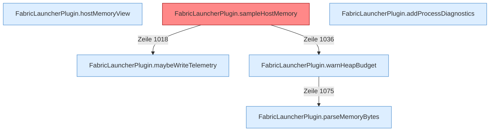

[[00 Start]] › [[Host-Betrieb]] › [[Speicher-Probe]]

# Speicher-Probe



```knoten
FabricLauncherPlugin.hostMemoryView
  Stellt die Speichermessung so zusammen, wie die [[Glossar#Bedienseite|Bedienseite]] sie zeigt.
FabricLauncherPlugin.maybeWriteTelemetry
  Das [[Glossar#Plugin|Plugin]] macht, wenn die Zeit reif ist, das Aufschreiben die Messreihe.
FabricLauncherPlugin.sampleHostMemory
  Misst einmal den [[Glossar#Arbeitsspeicher|Arbeitsspeicher]] des [[Glossar#Host|Host]] und entscheidet, ob der [[Glossar#Spielserver|Spielserver]] wegen Mangels aus muss. Auffällig: ein alter Weg läuft noch mit. Das nennt man [[Glossar#Altlast|Altlast]].
FabricLauncherPlugin.warnHeapBudget
  Das [[Glossar#Plugin|Plugin]] warnt vor den Programmspeicher die Grenze.
FabricLauncherPlugin.parseMemoryBytes
  Das [[Glossar#Plugin|Plugin]] liest den [[Glossar#Arbeitsspeicher|Arbeitsspeicher]] die Größe.
FabricLauncherPlugin.addProcessDiagnostics
  Das [[Glossar#Plugin|Plugin]] fügt hinzu das laufende Programm die [[Glossar#Diagnose|Diagnose]].
```

> [!knoten] Was die Blöcke tun
> - **FabricLauncherPlugin.hostMemoryView**: Stellt die Speichermessung so zusammen, wie die [[Glossar#Bedienseite|Bedienseite]] sie zeigt.
> - **FabricLauncherPlugin.maybeWriteTelemetry**: Das [[Glossar#Plugin|Plugin]] macht, wenn die Zeit reif ist, das Aufschreiben die Messreihe.
> - **FabricLauncherPlugin.sampleHostMemory**: Misst einmal den [[Glossar#Arbeitsspeicher|Arbeitsspeicher]] des [[Glossar#Host|Host]] und entscheidet, ob der [[Glossar#Spielserver|Spielserver]] wegen Mangels aus muss. Auffällig: ein alter Weg läuft noch mit. Das nennt man [[Glossar#Altlast|Altlast]].
> - **FabricLauncherPlugin.warnHeapBudget**: Das [[Glossar#Plugin|Plugin]] warnt vor den Programmspeicher die Grenze.
> - **FabricLauncherPlugin.parseMemoryBytes**: Das [[Glossar#Plugin|Plugin]] liest den [[Glossar#Arbeitsspeicher|Arbeitsspeicher]] die Größe.
> - **FabricLauncherPlugin.addProcessDiagnostics**: Das [[Glossar#Plugin|Plugin]] fügt hinzu das laufende Programm die [[Glossar#Diagnose|Diagnose]].

- Misst in einem festen Abstand, wie viel [[Glossar#Arbeitsspeicher|Arbeitsspeicher]] noch frei ist.
