[[00 Start]] › [[Host-Betrieb]] › [[Speicher-Stopp]]

# Speicher-Stopp

```mermaid
flowchart TD
  n1["FabricLauncherPlugin.applyCurrentMemorySettings"]:::internal-link
  n2["FabricLauncherPlugin.loadMemoryRecoveryState"]:::internal-link
  n3["FabricLauncherPlugin.loadLatestMemoryIncidentReport"]:::internal-link
  n4["FabricLauncherPlugin.memoryRecoveryFile"]:::internal-link
  n5["FabricLauncherPlugin.clearMemoryRecoveryState"]:::internal-link
  n6["FabricLauncherPlugin.resumeConfiguredAutoStart"]:::internal-link
  n7["FabricLauncherPlugin.requestChildEmergencyStop"]:::internal-link
  n8["FabricLauncherPlugin.writeMemoryIncidentReport"]:::internal-link
  n2 -->|"Z.975"| n4
  n5 -->|"Z.1131"| n4
  n7 -->|"Z.1151"| n4
  n7 -->|"Z.1181"| n8
  classDef internal-link fill:#ddeeff,stroke:#4488cc
  classDef befund fill:#f88
  style n7 fill:#f88,stroke:#900
```



```knoten
FabricLauncherPlugin.applyCurrentMemorySettings
  Wendet an `applyCurrentMemorySettings`. Ruft `saveConfigWritable`.
FabricLauncherPlugin.loadMemoryRecoveryState
  Lädt `loadMemoryRecoveryState`. Ruft `memoryRecoveryFile`.
FabricLauncherPlugin.loadLatestMemoryIncidentReport
  Lädt `loadLatestMemoryIncidentReport`.
FabricLauncherPlugin.memoryRecoveryFile
  Betrifft den Speicher `memoryRecoveryFile`.
FabricLauncherPlugin.clearMemoryRecoveryState
  Leert `clearMemoryRecoveryState`. Ruft `memoryRecoveryFile`, `finishRecovery`.
FabricLauncherPlugin.resumeConfiguredAutoStart
  Setzt fort `resumeConfiguredAutoStart`. Ruft `notifyNtfy`, `startAsync`.
FabricLauncherPlugin.requestChildEmergencyStop
  Stoppt den Child. Logtext sagt Emergency restart. Befund: Kommentar widerspricht Code (sicher).
FabricLauncherPlugin.writeMemoryIncidentReport
  Schreibt `writeMemoryIncidentReport`. Ruft `snapshot`, `cgroupUsePercent`, `criticalSamples`.
```


