[[00 Start]] › [[Host-Betrieb]] › [[Speicher-Stopp]]

# Speicher-Stopp

```mermaid
flowchart TD
  n1["FabricLauncherPlugin.applyCurrentMemorySettings"]:::internal-link
  n2["FabricLauncherPlugin.loadMemoryRecoveryState"]:::internal-link
  n3["FabricLauncherPlugin.loadLatestMemoryIncidentReport"]:::internal-link
  n4["FabricLauncherPlugin.memoryRecoveryFile"]:::internal-link
  n5["FabricLauncherPlugin.clearMemoryRecoveryState"]:::internal-link
  n6["FabricLauncherPlugin.resumeConfiguredAutoStart"]:::internal-link
  n7["FabricLauncherPlugin.requestChildEmergencyStop"]:::internal-link
  n8["FabricLauncherPlugin.writeMemoryIncidentReport"]:::internal-link
  n2 -->|"Zeile 975"| n4
  n5 -->|"Zeile 1131"| n4
  n7 -->|"Zeile 1151"| n4
  n7 -->|"Zeile 1181"| n8
  classDef internal-link fill:#ddeeff,stroke:#4488cc
  classDef befund fill:#f88
  style n7 fill:#f88,stroke:#900
```



```knoten
FabricLauncherPlugin.applyCurrentMemorySettings
  Das [[Glossar#Plugin|Plugin]] wendet an den aktuellen Stand den [[Glossar#Arbeitsspeicher|Arbeitsspeicher]] die [[Glossar#Einstellungen|Einstellungen]].
FabricLauncherPlugin.loadMemoryRecoveryState
  Das [[Glossar#Plugin|Plugin]] lädt den [[Glossar#Arbeitsspeicher|Arbeitsspeicher]] die Wiederherstellung den Zustand.
FabricLauncherPlugin.loadLatestMemoryIncidentReport
  Das [[Glossar#Plugin|Plugin]] lädt den letzten Stand den [[Glossar#Arbeitsspeicher|Arbeitsspeicher]] den [[Glossar#Vorfall|Vorfall]] den Bericht.
FabricLauncherPlugin.memoryRecoveryFile
  Die Datei, in der steht, ob der Speicher nach einem [[Glossar#Vorfall|Vorfall]] schon wieder freigegeben wurde.
FabricLauncherPlugin.clearMemoryRecoveryState
  Das [[Glossar#Plugin|Plugin]] löscht den gemerkten Stand von den [[Glossar#Arbeitsspeicher|Arbeitsspeicher]] die Wiederherstellung den Zustand.
FabricLauncherPlugin.resumeConfiguredAutoStart
  Schaltet das automatische Starten wieder so ein, wie es in den [[Glossar#Einstellungen|Einstellungen]] steht.
FabricLauncherPlugin.requestChildEmergencyStop
  Schaltet den [[Glossar#Spielserver|Spielserver]] wegen Speichermangels aus. Die Meldung spricht von einem [[Glossar#Neustart|Neustart]], neu gestartet wird nicht. Auffällig: ein Kommentar oder eine Meldung sagt etwas anderes als der Ablauf. Das nennt man [[Glossar#Widerspruch|Widerspruch]].
FabricLauncherPlugin.writeMemoryIncidentReport
  Das [[Glossar#Plugin|Plugin]] schreibt den [[Glossar#Arbeitsspeicher|Arbeitsspeicher]] den [[Glossar#Vorfall|Vorfall]] den Bericht.
```

> [!knoten] Was die Blöcke tun
> - **FabricLauncherPlugin.applyCurrentMemorySettings**: Das [[Glossar#Plugin|Plugin]] wendet an den aktuellen Stand den [[Glossar#Arbeitsspeicher|Arbeitsspeicher]] die [[Glossar#Einstellungen|Einstellungen]].
> - **FabricLauncherPlugin.loadMemoryRecoveryState**: Das [[Glossar#Plugin|Plugin]] lädt den [[Glossar#Arbeitsspeicher|Arbeitsspeicher]] die Wiederherstellung den Zustand.
> - **FabricLauncherPlugin.loadLatestMemoryIncidentReport**: Das [[Glossar#Plugin|Plugin]] lädt den letzten Stand den [[Glossar#Arbeitsspeicher|Arbeitsspeicher]] den [[Glossar#Vorfall|Vorfall]] den Bericht.
> - **FabricLauncherPlugin.memoryRecoveryFile**: Die Datei, in der steht, ob der Speicher nach einem [[Glossar#Vorfall|Vorfall]] schon wieder freigegeben wurde.
> - **FabricLauncherPlugin.clearMemoryRecoveryState**: Das [[Glossar#Plugin|Plugin]] löscht den gemerkten Stand von den [[Glossar#Arbeitsspeicher|Arbeitsspeicher]] die Wiederherstellung den Zustand.
> - **FabricLauncherPlugin.resumeConfiguredAutoStart**: Schaltet das automatische Starten wieder so ein, wie es in den [[Glossar#Einstellungen|Einstellungen]] steht.
> - **FabricLauncherPlugin.requestChildEmergencyStop**: Schaltet den [[Glossar#Spielserver|Spielserver]] wegen Speichermangels aus. Die Meldung spricht von einem [[Glossar#Neustart|Neustart]], neu gestartet wird nicht. Auffällig: ein Kommentar oder eine Meldung sagt etwas anderes als der Ablauf. Das nennt man [[Glossar#Widerspruch|Widerspruch]].
> - **FabricLauncherPlugin.writeMemoryIncidentReport**: Das [[Glossar#Plugin|Plugin]] schreibt den [[Glossar#Arbeitsspeicher|Arbeitsspeicher]] den [[Glossar#Vorfall|Vorfall]] den Bericht.

- Wird der [[Glossar#Arbeitsspeicher|Arbeitsspeicher]] knapp, schaltet das [[Glossar#Plugin|Plugin]] den [[Glossar#Spielserver|Spielserver]] aus. Eine Meldung spricht von [[Glossar#Neustart|Neustart]], neu gestartet wird aber nicht.
