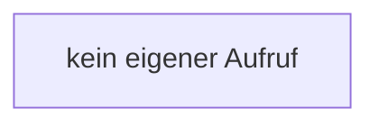

[[00 Start]] › [[Server-Anlage]] › [[Startplan]] › [[SpigotBuilder]] › [[SpigotBuilder.SpigotBuilder]]

# SpigotBuilder.SpigotBuilder

`SpigotBuilder.SpigotBuilder()` [src/main/java/de/aichele/childlauncher/SpigotBuilder.java:15–15](https://github.com/Sciddie/minecraft-serverhoster-plugin/blob/95b02b953b0b4c23673e900e021a7c3c844aa37d/src/main/java/de/aichele/childlauncher/SpigotBuilder.java#L15-L15)

- `SpigotBuilder` in `src/main/java/de/aichele/childlauncher/SpigotBuilder.java`
