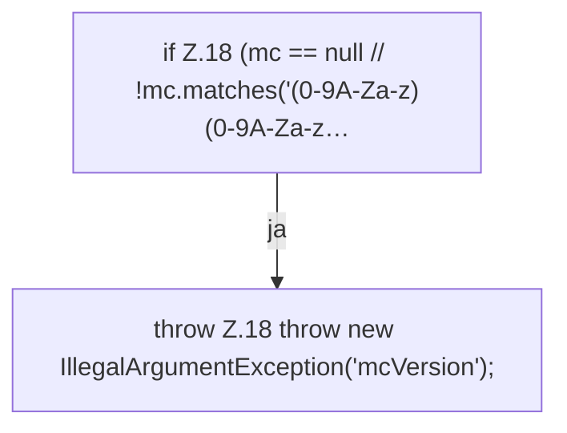

[[00 Start]] › [[Server-Anlage]] › [[Startplan]] › [[SpigotBuilder]] › [[SpigotBuilder.assertRev]]

# SpigotBuilder.assertRev

`SpigotBuilder.assertRev(String mc)` [src/main/java/de/aichele/childlauncher/SpigotBuilder.java:17–19](https://github.com/Sciddie/minecraft-serverhoster-plugin/blob/95b02b953b0b4c23673e900e021a7c3c844aa37d/src/main/java/de/aichele/childlauncher/SpigotBuilder.java#L17-L19)



```knoten
if Z.18 (mc == null // !mc.matches('(0-9A-Za-z)(0-9A-Za-z…
  Zeile 18: prüft `(mc == null // !mc.matches('(0-9A-Za-z)(0-9A-Za-z…`.
throw Z.18 throw new IllegalArgumentException('mcVersion');
  Zeile 18: Abbruch `throw new IllegalArgumentException('mcVersion');`.
```

- `assertRev` in `src/main/java/de/aichele/childlauncher/SpigotBuilder.java`
