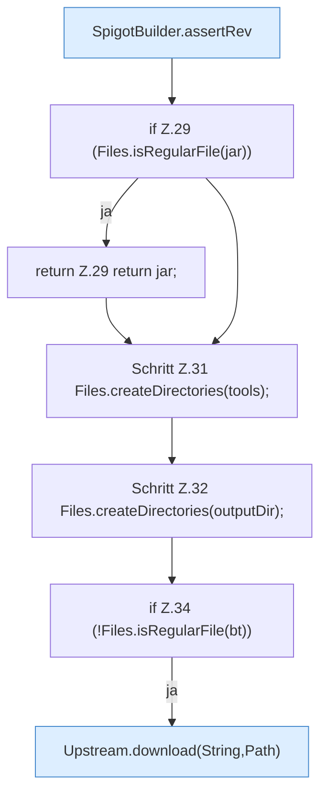

[[00 Start]] › [[Server-Anlage]] › [[Startplan]] › [[SpigotBuilder]] › [[SpigotBuilder.build]] › [[SpigotBuilder.build.Teil1]]

# SpigotBuilder.build.Teil1



```knoten
SpigotBuilder.assertRev
  Dieser Teil macht hier einen einzelnen Schritt. Eine Ebene tiefer steht er genauer. Prüft `assertRev`.
if Z.29 (Files.isRegularFile(jar))
  Zeile 29: prüft `(Files.isRegularFile(jar))`.
return Z.29 return jar;
  Zeile 29: Rückgabe `return jar;`.
Schritt Z.31 Files.createDirectories(tools);
  Zeile 31: Dateioperation. `Files.createDirectories(tools);`
Schritt Z.32 Files.createDirectories(outputDir);
  Zeile 32: Dateioperation. `Files.createDirectories(outputDir);`
if Z.34 (!Files.isRegularFile(bt))
  Zeile 34: prüft `(!Files.isRegularFile(bt))`.
Upstream.download(String,Path)
  Dieser Teil holt das. Liefert zum Herunterladen `download`. Ruft `download`.
```

> [!knoten]- Was die Blöcke tun
> - **SpigotBuilder.assertRev**: Dieser Teil macht hier einen einzelnen Schritt. Eine Ebene tiefer steht er genauer. Prüft `assertRev`.
> - **if Z.29 (Files.isRegularFile(jar))**: Zeile 29: prüft `(Files.isRegularFile(jar))`.
> - **return Z.29 return jar;**: Zeile 29: Rückgabe `return jar;`.
> - **Schritt Z.31 Files.createDirectories(tools);**: Zeile 31: Dateioperation. `Files.createDirectories(tools);`
> - **Schritt Z.32 Files.createDirectories(outputDir);**: Zeile 32: Dateioperation. `Files.createDirectories(outputDir);`
> - **if Z.34 (!Files.isRegularFile(bt))**: Zeile 34: prüft `(!Files.isRegularFile(bt))`.
> - **Upstream.download(String,Path)**: Dieser Teil holt das. Liefert zum Herunterladen `download`. Ruft `download`.

- Ein weiterer Abschnitt derselben Übersicht.
- Fortsetzung von `SpigotBuilder.build`.
