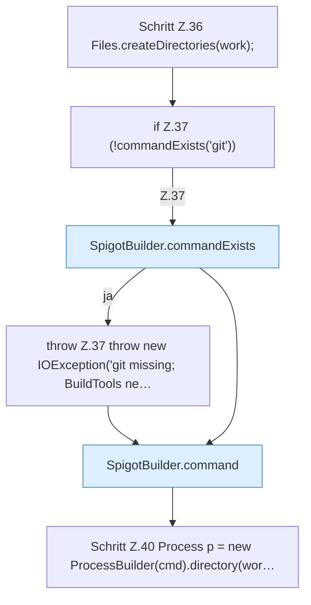

[[00 Start]] › [[Server-Anlage]] › [[Startplan]] › [[SpigotBuilder]] › [[SpigotBuilder.build]] › [[SpigotBuilder.build.Teil2]]

# SpigotBuilder.build.Teil2



```knoten
Schritt Z.36 Files.createDirectories(work);
  Zeile 36: Dateioperation. `Files.createDirectories(work);`
if Z.37 (!commandExists('git'))
  Zeile 37: prüft `(!commandExists('git'))`.
SpigotBuilder.commandExists
  Dieser Teil macht hier einen einzelnen Schritt. Eine Ebene tiefer steht er genauer. `commandExists` in `SpigotBuilder.java`.
throw Z.37 throw new IOException('git missing; BuildTools ne…
  Zeile 37: Abbruch `throw new IOException('git missing; BuildTools ne…`.
SpigotBuilder.command
  Dieser Teil macht hier einen einzelnen Schritt. Eine Ebene tiefer steht er genauer. `command` in `SpigotBuilder.java`. Ruft `assertRev`.
Schritt Z.40 Process p = new ProcessBuilder(cmd).directory(wor…
  Zeile 40: baut einen Prozess. `Process p = new ProcessBuilder(cmd).directory(wor…`
```

> [!knoten]- Was die Blöcke tun
> - **Schritt Z.36 Files.createDirectories(work);**: Zeile 36: Dateioperation. `Files.createDirectories(work);`
> - **if Z.37 (!commandExists('git'))**: Zeile 37: prüft `(!commandExists('git'))`.
> - **SpigotBuilder.commandExists**: Dieser Teil macht hier einen einzelnen Schritt. Eine Ebene tiefer steht er genauer. `commandExists` in `SpigotBuilder.java`.
> - **throw Z.37 throw new IOException('git missing; BuildTools ne…**: Zeile 37: Abbruch `throw new IOException('git missing; BuildTools ne…`.
> - **SpigotBuilder.command**: Dieser Teil macht hier einen einzelnen Schritt. Eine Ebene tiefer steht er genauer. `command` in `SpigotBuilder.java`. Ruft `assertRev`.
> - **Schritt Z.40 Process p = new ProcessBuilder(cmd).directory(wor…**: Zeile 40: baut einen Prozess. `Process p = new ProcessBuilder(cmd).directory(wor…`

- Ein weiterer Abschnitt derselben Übersicht.
- Fortsetzung von `SpigotBuilder.build`.
