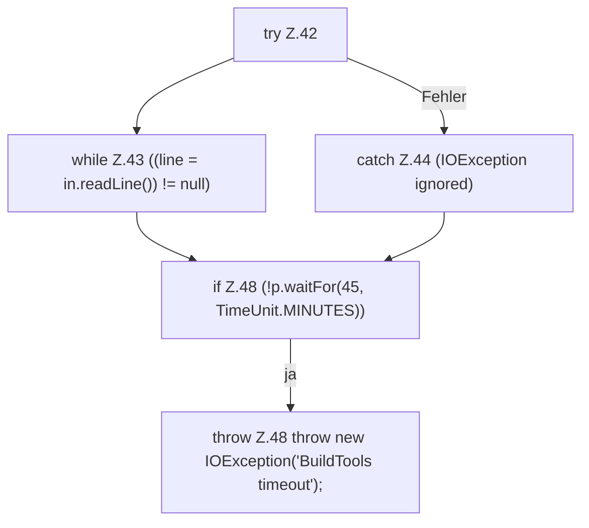

[[00 Start]] › [[Server-Anlage]] › [[Startplan]] › [[SpigotBuilder]] › [[SpigotBuilder.build]] › [[SpigotBuilder.build.Teil3]]

# SpigotBuilder.build.Teil3



```knoten
try Z.42
  Zeile 42: Versuch. Der Fehlerpfad geht in catch.
while Z.43 ((line = in.readLine()) != null)
  Zeile 43: Schleife `((line = in.readLine()) != null)`.
catch Z.44 (IOException ignored)
  Zeile 44: fängt (IOException ignored).
if Z.48 (!p.waitFor(45, TimeUnit.MINUTES))
  Zeile 48: prüft `(!p.waitFor(45, TimeUnit.MINUTES))`.
throw Z.48 throw new IOException('BuildTools timeout');
  Zeile 48: Abbruch `throw new IOException('BuildTools timeout');`.
```

> [!knoten]- Was die Blöcke tun
> - **try Z.42**: Zeile 42: Versuch. Der Fehlerpfad geht in catch.
> - **while Z.43 ((line = in.readLine()) != null)**: Zeile 43: Schleife `((line = in.readLine()) != null)`.
> - **catch Z.44 (IOException ignored)**: Zeile 44: fängt (IOException ignored).
> - **if Z.48 (!p.waitFor(45, TimeUnit.MINUTES))**: Zeile 48: prüft `(!p.waitFor(45, TimeUnit.MINUTES))`.
> - **throw Z.48 throw new IOException('BuildTools timeout');**: Zeile 48: Abbruch `throw new IOException('BuildTools timeout');`.

- Ein weiterer Abschnitt derselben Übersicht.
- Fortsetzung von `SpigotBuilder.build`.
