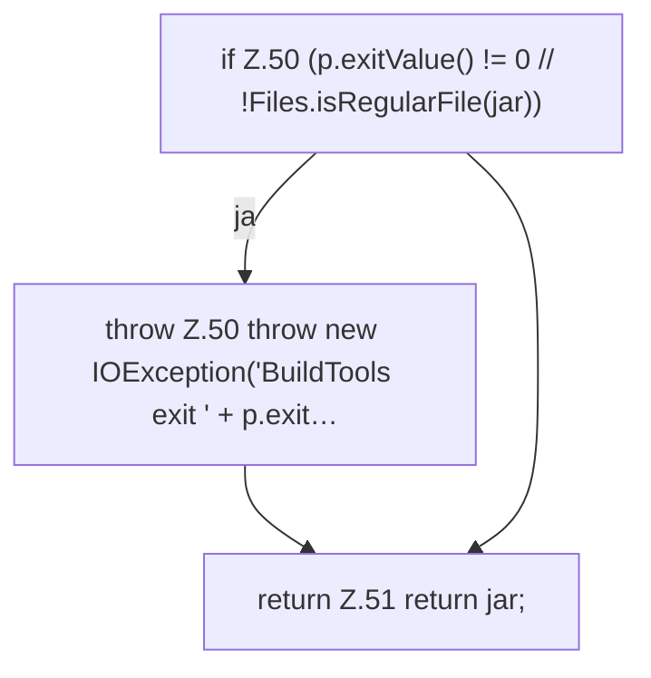

[[00 Start]] › [[Server-Anlage]] › [[Startplan]] › [[SpigotBuilder]] › [[SpigotBuilder.build]] › [[SpigotBuilder.build.Teil4]]

# SpigotBuilder.build.Teil4

- Fortsetzung von `SpigotBuilder.build`, Quellreihenfolge.
