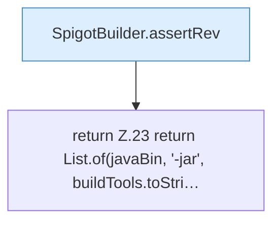

[[00 Start]] › [[Server-Anlage]] › [[Startplan]] › [[SpigotBuilder]] › [[SpigotBuilder.command]]

# SpigotBuilder.command

`SpigotBuilder.command(String javaBin, Path buildTools, String mc, Path outputDir)` [src/main/java/de/aichele/childlauncher/SpigotBuilder.java:21–24](https://github.com/Sciddie/minecraft-serverhoster-plugin/blob/95b02b953b0b4c23673e900e021a7c3c844aa37d/src/main/java/de/aichele/childlauncher/SpigotBuilder.java#L21-L24)



```knoten
SpigotBuilder.assertRev
  Dieser Teil macht hier einen einzelnen Schritt. Eine Ebene tiefer steht er genauer. Prüft `assertRev`.
return Z.23 return List.of(javaBin, '-jar', buildTools.toStri…
  Zeile 23: Rückgabe `return List.of(javaBin, '-jar', buildTools.toStri…`.
```

> [!knoten]- Was die Blöcke tun
> - **SpigotBuilder.assertRev**: Dieser Teil macht hier einen einzelnen Schritt. Eine Ebene tiefer steht er genauer. Prüft `assertRev`.
> - **return Z.23 return List.of(javaBin, '-jar', buildTools.toStri…**: Zeile 23: Rückgabe `return List.of(javaBin, '-jar', buildTools.toStri…`.

- Dieser Teil macht hier einen einzelnen Schritt. Eine Ebene tiefer steht er genauer.
- `command` in `src/main/java/de/aichele/childlauncher/SpigotBuilder.java`
