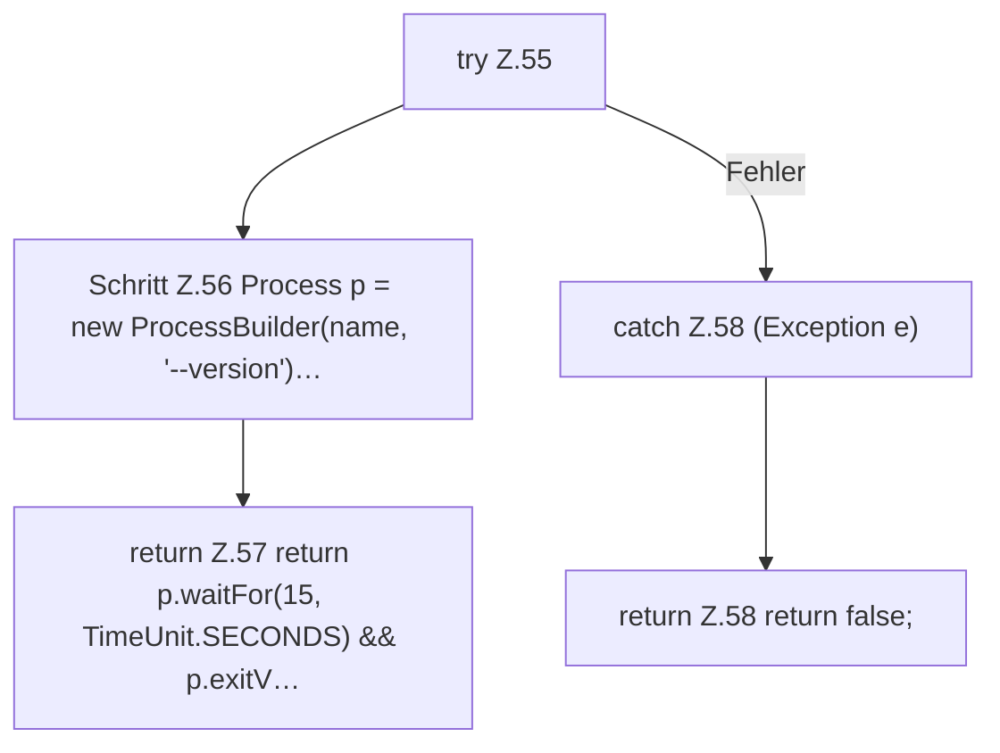

[[00 Start]] › [[Server-Anlage]] › [[Startplan]] › [[SpigotBuilder]] › [[SpigotBuilder.commandExists]]

# SpigotBuilder.commandExists

`SpigotBuilder.commandExists(String name)` [src/main/java/de/aichele/childlauncher/SpigotBuilder.java:54–59](https://github.com/Sciddie/minecraft-serverhoster-plugin/blob/95b02b953b0b4c23673e900e021a7c3c844aa37d/src/main/java/de/aichele/childlauncher/SpigotBuilder.java#L54-L59)



```knoten
try Z.55
  Zeile 55: Versuch. Der Fehlerpfad geht in catch.
Schritt Z.56 Process p = new ProcessBuilder(name, '--version')…
  Zeile 56: baut einen Prozess. `Process p = new ProcessBuilder(name, '--version')…`
return Z.57 return p.waitFor(15, TimeUnit.SECONDS) && p.exitV…
  Zeile 57: Rückgabe `return p.waitFor(15, TimeUnit.SECONDS) && p.exitV…`.
catch Z.58 (Exception e)
  Zeile 58: fängt (Exception e).
return Z.58 return false;
  Zeile 58: Rückgabe `return false;`.
```

> [!knoten]- Was die Blöcke tun
> - **try Z.55**: Zeile 55: Versuch. Der Fehlerpfad geht in catch.
> - **Schritt Z.56 Process p = new ProcessBuilder(name, '--version')…**: Zeile 56: baut einen Prozess. `Process p = new ProcessBuilder(name, '--version')…`
> - **return Z.57 return p.waitFor(15, TimeUnit.SECONDS) && p.exitV…**: Zeile 57: Rückgabe `return p.waitFor(15, TimeUnit.SECONDS) && p.exitV…`.
> - **catch Z.58 (Exception e)**: Zeile 58: fängt (Exception e).
> - **return Z.58 return false;**: Zeile 58: Rückgabe `return false;`.

- Dieser Teil macht hier einen einzelnen Schritt. Eine Ebene tiefer steht er genauer.
- `commandExists` in `src/main/java/de/aichele/childlauncher/SpigotBuilder.java`
