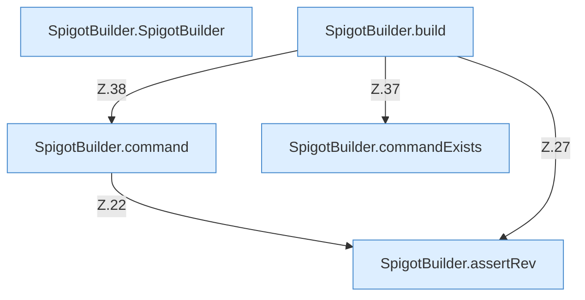

[[00 Start]] › [[Server-Anlage]] › [[Startplan]] › [[SpigotBuilder]]

# SpigotBuilder



```knoten
SpigotBuilder.SpigotBuilder
  Dieser Teil macht hier einen einzelnen Schritt. Eine Ebene tiefer steht er genauer. Im [[Glossar#Quelltext|Quelltext]] heißt das `SpigotBuilder`.
SpigotBuilder.assertRev
  Dieser Teil macht hier einen einzelnen Schritt. Eine Ebene tiefer steht er genauer. Im [[Glossar#Quelltext|Quelltext]] heißt das `assertRev`.
SpigotBuilder.command
  Dieser Teil macht hier einen einzelnen Schritt. Eine Ebene tiefer steht er genauer. Im [[Glossar#Quelltext|Quelltext]] heißt das `command`.
SpigotBuilder.build
  Dieser Teil baut das. Im [[Glossar#Quelltext|Quelltext]] heißt das `build`.
SpigotBuilder.commandExists
  Dieser Teil macht hier einen einzelnen Schritt. Eine Ebene tiefer steht er genauer. Im [[Glossar#Quelltext|Quelltext]] heißt das `commandExists`.
```

> [!knoten]- Was die Blöcke tun
> - **SpigotBuilder.SpigotBuilder**: Dieser Teil macht hier einen einzelnen Schritt. Eine Ebene tiefer steht er genauer. Im [[Glossar#Quelltext|Quelltext]] heißt das `SpigotBuilder`.
> - **SpigotBuilder.assertRev**: Dieser Teil macht hier einen einzelnen Schritt. Eine Ebene tiefer steht er genauer. Im [[Glossar#Quelltext|Quelltext]] heißt das `assertRev`.
> - **SpigotBuilder.command**: Dieser Teil macht hier einen einzelnen Schritt. Eine Ebene tiefer steht er genauer. Im [[Glossar#Quelltext|Quelltext]] heißt das `command`.
> - **SpigotBuilder.build**: Dieser Teil baut das. Im [[Glossar#Quelltext|Quelltext]] heißt das `build`.
> - **SpigotBuilder.commandExists**: Dieser Teil macht hier einen einzelnen Schritt. Eine Ebene tiefer steht er genauer. Im [[Glossar#Quelltext|Quelltext]] heißt das `commandExists`.

- Besorgt die [[Glossar#Programmdatei|Programmdatei]] für einen Spigot-Server, indem es sie lädt oder baut.
