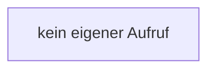

[[00 Start]] › [[Child-Prozess]] › [[Prozess-Bausteine]] › [[StartFailureStatus]] › [[StartFailureStatus.StartFailureStatus]]

# StartFailureStatus.StartFailureStatus

`StartFailureStatus.StartFailureStatus()` [src/main/java/de/aichele/childlauncher/StartFailureStatus.java:5–5](https://github.com/Sciddie/minecraft-serverhoster-plugin/blob/95b02b953b0b4c23673e900e021a7c3c844aa37d/src/main/java/de/aichele/childlauncher/StartFailureStatus.java#L5-L5)

- `StartFailureStatus` in `src/main/java/de/aichele/childlauncher/StartFailureStatus.java`
