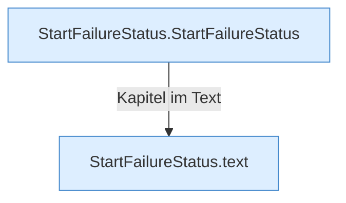

[[00 Start]] › [[Child-Prozess]] › [[Prozess-Bausteine]] › [[StartFailureStatus]]

# StartFailureStatus



```knoten
StartFailureStatus.StartFailureStatus
  Dieser Teil startet den Zustand. Im [[Glossar#Quelltext|Quelltext]] heißt das `StartFailureStatus`.
StartFailureStatus.text
  Dieser Teil macht hier einen einzelnen Schritt. Eine Ebene tiefer steht er genauer. Im [[Glossar#Quelltext|Quelltext]] heißt das `text`.
```

> [!knoten]- Was die Blöcke tun
> - **StartFailureStatus.StartFailureStatus**: Dieser Teil startet den Zustand. Im [[Glossar#Quelltext|Quelltext]] heißt das `StartFailureStatus`.
> - **StartFailureStatus.text**: Dieser Teil macht hier einen einzelnen Schritt. Eine Ebene tiefer steht er genauer. Im [[Glossar#Quelltext|Quelltext]] heißt das `text`.

- Merkt sich, woran ein Start gescheitert ist, damit man es in der [[Glossar#Bedienseite|Bedienseite]] sieht.
