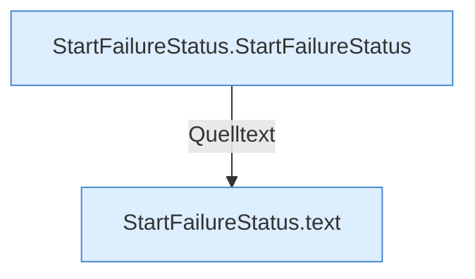

[[00 Start]] › [[Child-Prozess]] › [[Prozess-Bausteine]] › [[StartFailureStatus]]

# StartFailureStatus



```knoten
StartFailureStatus.StartFailureStatus
  Startet `StartFailureStatus`.
StartFailureStatus.text
  Antwortet mit Text `text`.
```


