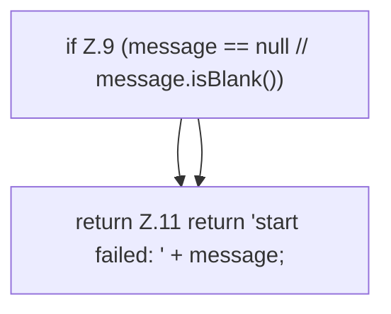

[[00 Start]] › [[Child-Prozess]] › [[Prozess-Bausteine]] › [[StartFailureStatus]] › [[StartFailureStatus.text]]

# StartFailureStatus.text

`StartFailureStatus.text(Throwable error)` [src/main/java/de/aichele/childlauncher/StartFailureStatus.java:7–12](https://github.com/Sciddie/minecraft-serverhoster-plugin/blob/95b02b953b0b4c23673e900e021a7c3c844aa37d/src/main/java/de/aichele/childlauncher/StartFailureStatus.java#L7-L12)



```knoten
if Z.9 (message == null // message.isBlank())
  Zeile 9: prüft `(message == null // message.isBlank())`.
return Z.11 return 'start failed: ' + message;
  Zeile 11: Rückgabe `return 'start failed: ' + message;`.
```

- `text` in `src/main/java/de/aichele/childlauncher/StartFailureStatus.java`
