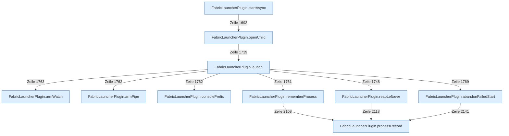

[[00 Start]] › [[Child-Prozess]] › [[Startablauf]]

# Startablauf



```knoten
FabricLauncherPlugin.startAsync
  Beginnt den Start des [[Glossar#Spielserver|Spielservers]] im Hintergrund, damit der [[Glossar#Host|Host]] dabei nicht stehen bleibt.
FabricLauncherPlugin.openChild
  Prüft, ob der [[Glossar#Platz|Platz]] frei ist, und gibt den Start dann weiter. Läuft er schon, passiert nichts.
FabricLauncherPlugin.launch
  Legt Ordner und Dateien an, schreibt die [[Glossar#Lizenz|Lizenz]], startet das Programm und schaltet Mitlesen und [[Glossar#Aufsicht|Aufsicht]] an. Scheitert das, wird aufgeräumt.
FabricLauncherPlugin.armWatch
  Schaltet die [[Glossar#Aufsicht|Aufsicht]] an, die merkt, wenn das Programm endet.
FabricLauncherPlugin.armPipe
  Schaltet das Mitlesen der [[Glossar#Konsole|Konsole]] an.
FabricLauncherPlugin.consolePrefix
  Setzt eine kurze Kennung vor jede [[Glossar#Zeile|Zeile]], damit man sie dem [[Glossar#Spielserver|Spielserver]] zuordnen kann.
FabricLauncherPlugin.processRecord
  Baut den Merkzettel zum Programm: Nummer und die Prüfungen, ob es noch lebt.
FabricLauncherPlugin.rememberProcess
  Merkt sich Programmnummer und [[Glossar#Programmdatei|Programmdatei]], damit das [[Glossar#Plugin|Plugin]] den [[Glossar#Spielserver|Spielserver]] später wiederfindet.
FabricLauncherPlugin.reapLeftover
  Beendet ein Programm, das von einem früheren Start noch übrig ist.
FabricLauncherPlugin.abandonFailedStart
  Bricht einen Start ab, der nicht geklappt hat, und setzt den Zustand zurück auf aus.
```

> [!knoten] Was die Blöcke tun
> - **FabricLauncherPlugin.startAsync**: Beginnt den Start des [[Glossar#Spielserver|Spielservers]] im Hintergrund, damit der [[Glossar#Host|Host]] dabei nicht stehen bleibt.
> - **FabricLauncherPlugin.openChild**: Prüft, ob der [[Glossar#Platz|Platz]] frei ist, und gibt den Start dann weiter. Läuft er schon, passiert nichts.
> - **FabricLauncherPlugin.launch**: Legt Ordner und Dateien an, schreibt die [[Glossar#Lizenz|Lizenz]], startet das Programm und schaltet Mitlesen und [[Glossar#Aufsicht|Aufsicht]] an. Scheitert das, wird aufgeräumt.
> - **FabricLauncherPlugin.armWatch**: Schaltet die [[Glossar#Aufsicht|Aufsicht]] an, die merkt, wenn das Programm endet.
> - **FabricLauncherPlugin.armPipe**: Schaltet das Mitlesen der [[Glossar#Konsole|Konsole]] an.
> - **FabricLauncherPlugin.consolePrefix**: Setzt eine kurze Kennung vor jede [[Glossar#Zeile|Zeile]], damit man sie dem [[Glossar#Spielserver|Spielserver]] zuordnen kann.
> - **FabricLauncherPlugin.processRecord**: Baut den Merkzettel zum Programm: Nummer und die Prüfungen, ob es noch lebt.
> - **FabricLauncherPlugin.rememberProcess**: Merkt sich Programmnummer und [[Glossar#Programmdatei|Programmdatei]], damit das [[Glossar#Plugin|Plugin]] den [[Glossar#Spielserver|Spielserver]] später wiederfindet.
> - **FabricLauncherPlugin.reapLeftover**: Beendet ein Programm, das von einem früheren Start noch übrig ist.
> - **FabricLauncherPlugin.abandonFailedStart**: Bricht einen Start ab, der nicht geklappt hat, und setzt den Zustand zurück auf aus.

- Der [[Glossar#Spielserver|Spielserver]] wird eingeschaltet. Das [[Glossar#Plugin|Plugin]] legt Dateien bereit, startet das Programm und beginnt, die Ausgabe mitzulesen. Scheitert der Start, räumt es wieder auf.
