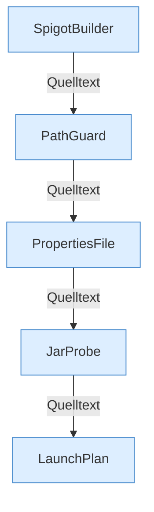

[[00 Start]] › [[Server-Anlage]] › [[Startplan]]

# Startplan



```knoten
SpigotBuilder
  Lädt oder baut das Spigot-Jar.
PathGuard
  Prüft, dass ein Pfad unter der erlaubten Wurzel bleibt.
PropertiesFile
  Liest und schreibt eine Properties-Datei.
JarProbe
  Liest Metadaten aus dem Server-Jar.
LaunchPlan
  Baut Argumente und Dateien für den Prozessstart.
```


