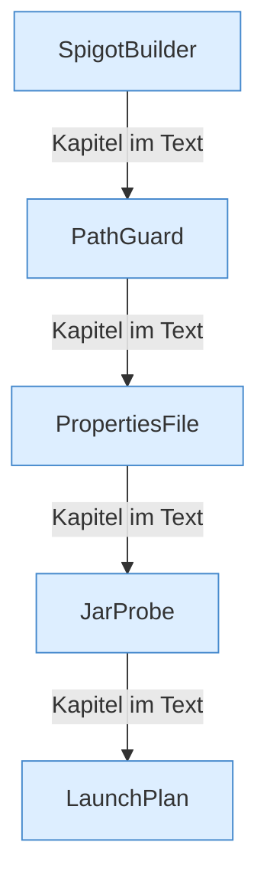

[[00 Start]] › [[Server-Anlage]] › [[Startplan]]

# Startplan



```knoten
SpigotBuilder
  Besorgt die [[Glossar#Programmdatei|Programmdatei]] für einen Spigot-Server, indem es sie lädt oder baut.
PathGuard
  Prüft, dass ein Ordner wirklich unter dem erlaubten Anfangsordner liegt, und nicht daneben.
PropertiesFile
  Liest und schreibt eine Eigenschaftsdatei, [[Glossar#Zeile|Zeile]] für Zeile.
JarProbe
  Sieht in die [[Glossar#Programmdatei|Programmdatei]] und liest ab, was für ein Server darin steckt.
LaunchPlan
  Baut die Argumente, mit denen das Programm des [[Glossar#Spielserver|Spielservers]] gestartet wird.
```

> [!knoten] Was die Blöcke tun
> - **SpigotBuilder**: Besorgt die [[Glossar#Programmdatei|Programmdatei]] für einen Spigot-Server, indem es sie lädt oder baut.
> - **PathGuard**: Prüft, dass ein Ordner wirklich unter dem erlaubten Anfangsordner liegt, und nicht daneben.
> - **PropertiesFile**: Liest und schreibt eine Eigenschaftsdatei, [[Glossar#Zeile|Zeile]] für Zeile.
> - **JarProbe**: Sieht in die [[Glossar#Programmdatei|Programmdatei]] und liest ab, was für ein Server darin steckt.
> - **LaunchPlan**: Baut die Argumente, mit denen das Programm des [[Glossar#Spielserver|Spielservers]] gestartet wird.

- Was zum Starten gebraucht wird: Eigenschaften, ein geprüfter Ordner, die Argumente, die [[Glossar#Programmdatei|Programmdatei]].
