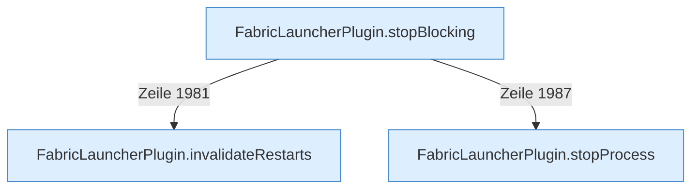

[[00 Start]] › [[Child-Prozess]] › [[Stopp]]

# Stopp



```knoten
FabricLauncherPlugin.stopBlocking
  Setzt den Zustand auf „stoppt“ und wartet, bis der [[Glossar#Spielserver|Spielserver]] wirklich aus ist.
FabricLauncherPlugin.stopProcess
  Fährt den [[Glossar#Spielserver|Spielserver]] herunter: erst die Bitte, dann Warten, dann ein hartes Beenden.
FabricLauncherPlugin.invalidateRestarts
  Vergisst geplante [[Glossar#Neustart|Neustarts]], damit ein absichtlicher [[Glossar#Stopp|Stopp]] nicht gleich wieder startet.
```

> [!knoten] Was die Blöcke tun
> - **FabricLauncherPlugin.stopBlocking**: Setzt den Zustand auf „stoppt“ und wartet, bis der [[Glossar#Spielserver|Spielserver]] wirklich aus ist.
> - **FabricLauncherPlugin.stopProcess**: Fährt den [[Glossar#Spielserver|Spielserver]] herunter: erst die Bitte, dann Warten, dann ein hartes Beenden.
> - **FabricLauncherPlugin.invalidateRestarts**: Vergisst geplante [[Glossar#Neustart|Neustarts]], damit ein absichtlicher [[Glossar#Stopp|Stopp]] nicht gleich wieder startet.

- Der [[Glossar#Spielserver|Spielserver]] wird heruntergefahren. Erst mit der Bitte aufzuhören, dann mit Warten, und nach einer Frist hart. Ein absichtlicher [[Glossar#Stopp|Stopp]] soll nicht gleich wieder starten.
