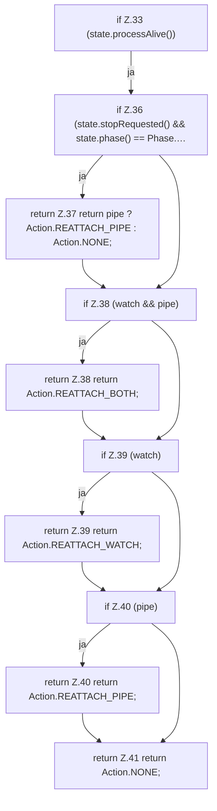

[[00 Start]] › [[Child-Prozess]] › [[Prozess-Bausteine]] › [[SupervisorHealth]] › [[SupervisorHealth.assess]] › [[SupervisorHealth.assess.Z33]]

# SupervisorHealth.assess.Z33



```knoten
if Z.33 (state.processAlive())
  Zeile 33: prüft `(state.processAlive())`.
if Z.36 (state.stopRequested() && state.phase() == Phase.…
  Zeile 36: prüft `(state.stopRequested() && state.phase() == Phase.…`.
return Z.37 return pipe ? Action.REATTACH_PIPE : Action.NONE;
  Zeile 37: Rückgabe `return pipe ? Action.REATTACH_PIPE : Action.NONE;`.
if Z.38 (watch && pipe)
  Zeile 38: prüft `(watch && pipe)`.
return Z.38 return Action.REATTACH_BOTH;
  Zeile 38: Rückgabe `return Action.REATTACH_BOTH;`.
if Z.39 (watch)
  Zeile 39: prüft `(watch)`.
return Z.39 return Action.REATTACH_WATCH;
  Zeile 39: Rückgabe `return Action.REATTACH_WATCH;`.
if Z.40 (pipe)
  Zeile 40: prüft `(pipe)`.
return Z.40 return Action.REATTACH_PIPE;
  Zeile 40: Rückgabe `return Action.REATTACH_PIPE;`.
return Z.41 return Action.NONE;
  Zeile 41: Rückgabe `return Action.NONE;`.
```

- Fortsetzung von `SupervisorHealth.assess`, Quellreihenfolge.
