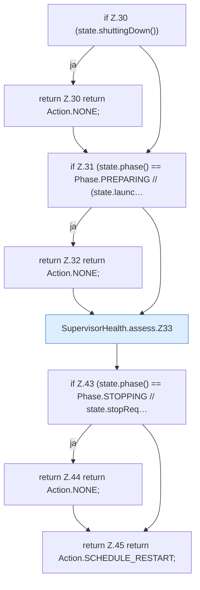

[[00 Start]] › [[Child-Prozess]] › [[Prozess-Bausteine]] › [[SupervisorHealth]] › [[SupervisorHealth.assess]]

# SupervisorHealth.assess

`SupervisorHealth.assess(State state)` [src/main/java/de/aichele/childlauncher/SupervisorHealth.java:29–46](https://github.com/Sciddie/minecraft-serverhoster-plugin/blob/95b02b953b0b4c23673e900e021a7c3c844aa37d/src/main/java/de/aichele/childlauncher/SupervisorHealth.java#L29-L46)



```knoten
if Z.30 (state.shuttingDown())
  Zeile 30: prüft `(state.shuttingDown())`.
return Z.30 return Action.NONE;
  Zeile 30: Rückgabe `return Action.NONE;`.
if Z.31 (state.phase() == Phase.PREPARING // (state.launc…
  Zeile 31: prüft `(state.phase() == Phase.PREPARING // (state.launc…`.
return Z.32 return Action.NONE;
  Zeile 32: Rückgabe `return Action.NONE;`.
SupervisorHealth.assess.Z33
  Der Ablauf geht in [[Glossar#Zeile|Zeile]] 33 weiter. Eine Ebene tiefer steht er genauer. Fortsetzung des Ablaufs ab Zeile 33.
if Z.43 (state.phase() == Phase.STOPPING // state.stopReq…
  Zeile 43: prüft `(state.phase() == Phase.STOPPING // state.stopReq…`.
return Z.44 return Action.NONE;
  Zeile 44: Rückgabe `return Action.NONE;`.
return Z.45 return Action.SCHEDULE_RESTART;
  Zeile 45: Rückgabe `return Action.SCHEDULE_RESTART;`.
```

> [!knoten]- Was die Blöcke tun
> - **if Z.30 (state.shuttingDown())**: Zeile 30: prüft `(state.shuttingDown())`.
> - **return Z.30 return Action.NONE;**: Zeile 30: Rückgabe `return Action.NONE;`.
> - **if Z.31 (state.phase() == Phase.PREPARING // (state.launc…**: Zeile 31: prüft `(state.phase() == Phase.PREPARING // (state.launc…`.
> - **return Z.32 return Action.NONE;**: Zeile 32: Rückgabe `return Action.NONE;`.
> - **SupervisorHealth.assess.Z33**: Der Ablauf geht in [[Glossar#Zeile|Zeile]] 33 weiter. Eine Ebene tiefer steht er genauer. Fortsetzung des Ablaufs ab Zeile 33.
> - **if Z.43 (state.phase() == Phase.STOPPING // state.stopReq…**: Zeile 43: prüft `(state.phase() == Phase.STOPPING // state.stopReq…`.
> - **return Z.44 return Action.NONE;**: Zeile 44: Rückgabe `return Action.NONE;`.
> - **return Z.45 return Action.SCHEDULE_RESTART;**: Zeile 45: Rückgabe `return Action.SCHEDULE_RESTART;`.

- Dieser Teil macht hier einen einzelnen Schritt. Eine Ebene tiefer steht er genauer.
- `assess` in `src/main/java/de/aichele/childlauncher/SupervisorHealth.java`
