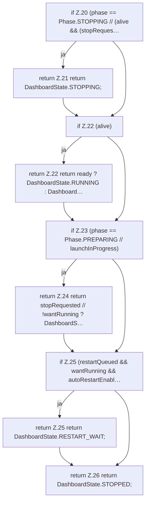

[[00 Start]] › [[Child-Prozess]] › [[Prozess-Bausteine]] › [[SupervisorHealth]] › [[SupervisorHealth.dashboardState]]

# SupervisorHealth.dashboardState

`SupervisorHealth.dashboardState(Phase phase, boolean alive, boolean ready, boolean wantRunning, boolean stopRequested, boolean launchInProgress, boolean restartQueued, boolean autoRestartEnabled)` [src/main/java/de/aichele/childlauncher/SupervisorHealth.java:17–27](https://github.com/Sciddie/minecraft-serverhoster-plugin/blob/95b02b953b0b4c23673e900e021a7c3c844aa37d/src/main/java/de/aichele/childlauncher/SupervisorHealth.java#L17-L27)

- `dashboardState` in `src/main/java/de/aichele/childlauncher/SupervisorHealth.java`
