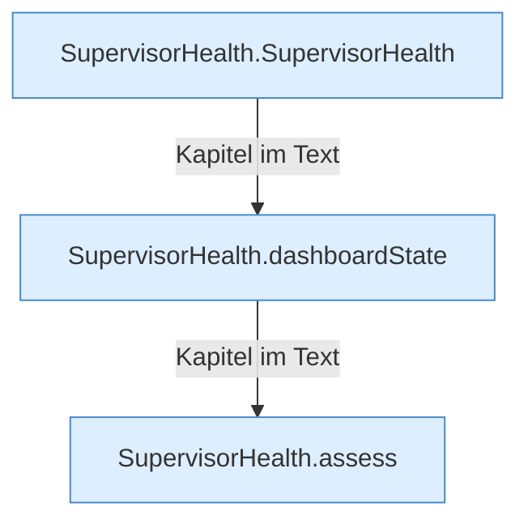

[[00 Start]] › [[Child-Prozess]] › [[Prozess-Bausteine]] › [[SupervisorHealth]]

# SupervisorHealth



```knoten
SupervisorHealth.SupervisorHealth
  Dieser Teil kümmert sich um den Zustand. Im [[Glossar#Quelltext|Quelltext]] heißt das `SupervisorHealth`.
SupervisorHealth.dashboardState
  Dieser Teil kümmert sich um den Zustand. Im [[Glossar#Quelltext|Quelltext]] heißt das `dashboardState`.
SupervisorHealth.assess
  Dieser Teil macht hier einen einzelnen Schritt. Eine Ebene tiefer steht er genauer. Im [[Glossar#Quelltext|Quelltext]] heißt das `assess`.
```

> [!knoten]- Was die Blöcke tun
> - **SupervisorHealth.SupervisorHealth**: Dieser Teil kümmert sich um den Zustand. Im [[Glossar#Quelltext|Quelltext]] heißt das `SupervisorHealth`.
> - **SupervisorHealth.dashboardState**: Dieser Teil kümmert sich um den Zustand. Im [[Glossar#Quelltext|Quelltext]] heißt das `dashboardState`.
> - **SupervisorHealth.assess**: Dieser Teil macht hier einen einzelnen Schritt. Eine Ebene tiefer steht er genauer. Im [[Glossar#Quelltext|Quelltext]] heißt das `assess`.

- Die vier Zustände aus, startet, läuft und stoppt, und die [[Glossar#Aufsicht|Aufsicht]] darüber.
